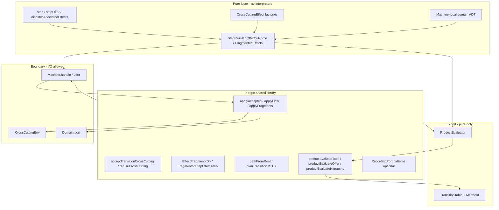
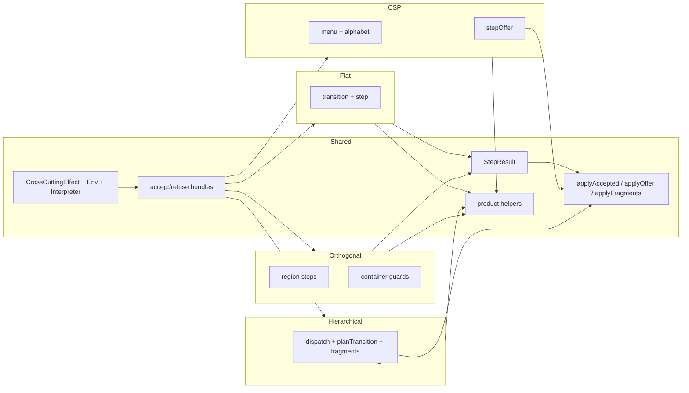
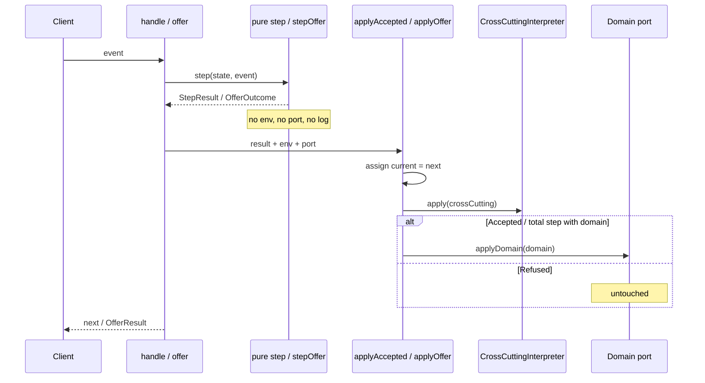
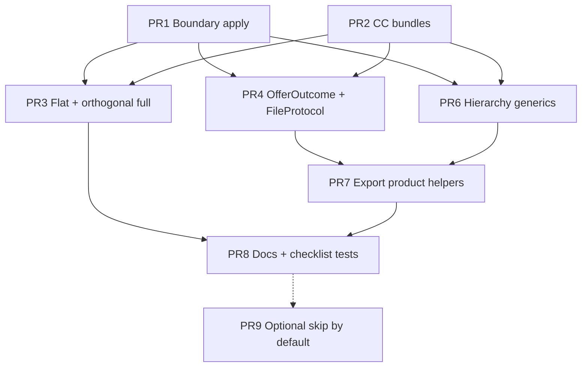

# Shared Machine Surfaces: Interfaces, Helpers, and Conventions for Correct New Machines

| Field | Value |
|-------|--------|
| **Author** | TBD |
| **Date** | 2026-07-24 |
| **Status** | Accepted (open questions resolved) |
| **Workspace** | `/Users/bstiles/Scratch/fsm` |
| **Audience** | Senior engineers and coding agents extending this sample |

## Current-state errata (shipped code)

This document began as a **planning / PR design** writeup. Prefer the project **README** as the agent authoring surface. Where historical sections below still show intermediate options, **shipped code** wins:

| Topic | Shipped (do this) | Historical text may still say |
|-------|-------------------|-------------------------------|
| CSP pure outcome | `OfferOutcome.Accepted` / `Refused` only — **no** `typealias OfferStep` | Optional signature-only `OfferStep` alias (R1) |
| Hierarchy API | Call `fsm.sample.machine.pathFromRoot` / `planTransition` / `dispatchWithDelegation` **directly** | Thin gof free-function wrappers that bind ConnState lambdas |
| Conn dispatch binding | Vignette-local `internal dispatchConnection` binds Conn lambdas once (handle / probe / tests) | Triplicated `dispatchWithDelegation(...)` lambda sets at each call site |
| Hierarchy export step | `productEvaluateHierarchy` takes `(S,E) -> HierarchyStep<S,D>` (sealed Handled/Unhandled + effects) | Separate `probe` + `isUnhandled` + `nextOf` + `declaredEffects` callbacks |
| `planTransition` | Optional `transitionExtras: List<CrossCuttingEffect> = emptyList()` on the leaf-change transition fragment | Signature without `transitionExtras` |
| Domain list ports | Vignette ports **subclass** `machine.RecordingPort<T>` (are the bag); specialized fields on same class | Private bag + pass-through `record`/`clear`/`items` shells |
| Container refuse | `applyRefusal(crossCutting, env)` | Raw `CrossCuttingInterpreter.apply` only |

---

## Overview

This project teaches classical FSM, hierarchical (GoF/Harel), orthogonal multi-region, and CSP-style process disciplines as **ordinary Kotlin**—no third-party statechart engine. The post–code-judo effects model is already strong: pure steps declare `StepResult` / offer / fragment assemblies; boundaries apply dual sinks (`CrossCuttingEnv` + machine-local ports); export product-evaluates pure APIs only.

What is **not** yet optimized is the *happy path for adding a fifth machine*. Each sample re-implements the same boundary loop, the same audit+metric preamble, the same refuse package, the same recording-port shape, and (for hierarchy) Connection-specific types that are structurally generic. Humans copy-paste carefully; coding agents invent slightly wrong variants (apply domain on refuse, call interpreters from pure step, nest audit into domain ADTs, skip export hooks).

This design proposes **in-repo, stdlib-only extractable surfaces**—interfaces, small library functions, and type-shaped conventions—that make the correct pattern the path of least resistance for both humans and agents, **without** inventing a full statechart engine or abandoning “ordinary code.”

---

## Background & Motivation

### Current state (cited)

| Kind | Primary sources | Pure surface | Boundary |
|------|-----------------|--------------|----------|
| Flat | `flat/TrafficLight.kt`, `flat/LightEffect.kt` | top-level `transition`, `step` → `StepResult<S,D>` | `TrafficLight.handle` |
| Hierarchical | `gof/ConnectionMachine.kt`, `gof/ConnectionEffect.kt` | `dispatchWithDelegation`, `planTransition`, `declaredEffects` | `ConnectionContext.handle` + fragment apply |
| Orthogonal | `orthogonal/DoorSystem.kt`, `orthogonal/DoorEffects.kt` | region `step` + pure `guardRefusalEffects` | region `handle` + container `handle` |
| CSP | `csp/FileProtocol.kt`, `csp/FileEffect.kt` | `stepOffer` → `OfferOutcome` | `FileProtocol.offer` |
| Shared effects | `effect/StepResult.kt`, `CrossCuttingEffect.kt`, `CrossCuttingEnv.kt`, `CrossCuttingInterpreter.kt` | declare lists | `CrossCuttingInterpreter.apply` |
| Export | `export/ProductEvaluator.kt`, `TransitionModel.kt` | product over sealed domains | **never** interpreters |

Shared vocabulary already exists:

```text
StepResult(next, crossCutting: List<CrossCuttingEffect>, domain: List<D>)
```

Cross-cutting families: Audit / Metric / Trace → `CrossCuttingEnv`. Domain ADTs stay machine-local (`LightEffect`, `FileEffect`, `ConnectionEffect`, `LatchEffect` / `SwingEffect`) → ports (`LightPort`, `FilePort`, `ConnectionPort`, `DoorPort`).

### Pain points when adding a new machine

1. **Boundary boilerplate is copy-pasted four ways, with two assign orders.** Flat/CSP/region paths do assign-state → `CrossCuttingInterpreter.apply` → `applyDomain*`. Hierarchy is the **opposite**: apply LCA fragments first, then assign leaf if it changed. CSP correctly omits domain on refuse; an agent reimplementing `offer` often applies domain always—or forces hierarchy through the flat assign-then-apply order.
2. **Three related outcome shapes.** Flat/orthogonal use `StepResult`; CSP uses `OfferStep` (Accepted/Refused); hierarchy uses `ConnectionStepEffects` + `EffectFragment` + `HandleResult`. Mental model load is high; nothing names the *protocol* each shape satisfies.
3. **Audit/metric preamble is ad hoc.** Almost every accept builds `auditTransition` + `metricInc("fsm.transitions")` + extras by hand (see `TrafficLight.step`, `LatchMachine.step`, `FileProtocol.stepOffer`, `planTransition`).
4. **Refuse packages are triplicated.** `FileProtocol.refuseCrossCutting`, `DoorSystem.guardRefusalEffects`, and `declaredEffects` Unhandled branch all assemble Audit.LogRefusal + refuse metric + Trace.Span with slightly different metric names.
5. **Hierarchy helpers are Connection-branded.** `EffectFragment`, `ConnectionStepEffects`, `pathFromRoot`, `commonPrefixLength`, `planTransition` are domain-generic but typed to `ConnectionEffect` / `ConnState`.
6. **Product evaluation is incomplete as a contract.** `productEvaluateTotal` covers total flat steps; CSP and hierarchy have bespoke evaluators. No single “what must a machine expose to be exportable” checklist encoded in types.
7. **Purity is convention-only.** Comments say pure steps must not call interpreters; nothing structural prevents `step` from touching a port. Agents sometimes “helpfully” log inside transitions.
8. **Recording ports duplicate structure.** `LightPort`, `FilePort`, `DoorPort`, and (partially) `ConnectionPort` are list/counter bags with `clear` / `snapshot`.
9. **Labels and export labels are freehand.** `label()` and `exportLabel()` patterns are consistent enough to document and lightly standardize, but not required by a shared type.

### Why this matters for coding agents

Agents succeed when:

- The **canonical boundary** is one function they must call (hard to mis-order sinks).
- Pure vs impure is **obvious at the type/API layer** (pure returns values; apply is only at boundary helpers).
- Refuse vs accept is a **sealed branch** that physically cannot carry domain on refuse (CSP already does this; flat total machines do not need it; partial machines should prefer it).
- Export wiring is a **short, copyable recipe** with a shared product helper for each kind.
- Checklists live as **test templates** that fail if purity or dual-sink discipline breaks.

---

## Goals & Non-Goals

### Goals

1. Extract **concrete, in-repo** shared surfaces that reduce mistakes when adding any of the four machine kinds.
2. Keep **ordinary code** discipline: sealed domains, `when` exhaustiveness, pure step + boundary apply, dual sinks.
3. Optimize for **humans and coding agents**: hard-to-misuse defaults, copy-paste recipes, sealed exhaustiveness.
4. Make **export product evaluation** a first-class consumer of the same pure APIs used at runtime.
5. Document **which abstractions are shared vs kind-specific**.
6. Deliver an incremental **PR plan** that is independently reviewable.

### Non-Goals

1. **No full statechart / FSM engine** (no transition tables as data, no generic runtime graph walker as the primary model of behavior).
2. **No external dependencies** beyond current stdlib + JUnit.
3. **No unification of all four kinds into one mega-type** that erases pedagogical differences.
4. **No reflection-based** sealed-subclass enumeration for product evaluation (keep explicit domain lists, as today).
5. **No rewriting domain vignettes** for style alone; extractions should be re-homings of proven patterns.
6. **No global domain Effect ADT** that mixes lamp, file, session, and door actuators.

---

## Proposed Design

### Design principles

1. **Declare vs apply remains sacred.** Pure functions return data; only boundary helpers call `CrossCuttingInterpreter` and domain apply.
2. **Split sinks stay split.** `List<CrossCuttingEffect>` never nests inside domain ADTs; domain ADTs never appear on `CrossCuttingEnv`.
3. **Kind-specific cores stay kind-specific.** Hierarchy LCA and CSP menus are not forced into flat `StepResult`.
4. **Genericize what is already duplicated**, brand only what teaches a discipline.
5. **Agent-friendly defaults:** prefer sealed outcomes that make illegal states unrepresentable (e.g. refuse without domain).

### Architecture of shared surfaces



### Package layout (proposed)

Keep samples under `fsm.sample.*`. Add a thin shared package that is **not** an engine:

```text
fsm.sample.effect/          # pure dual-sink outcomes + CC vocabulary
  StepResult.kt, CrossCutting*, factories
  OfferOutcome.kt           # NEW — partial dual-sink peer of StepResult
  CrossCuttingBundles.kt    # NEW — accept/refuse list builders (+ traceDetail)
fsm.sample.machine/         # NEW — boundary + hierarchy structure (not an engine)
  BoundaryApply.kt          # applyAccepted / applyOffer / applyFragments
  FragmentedEffects.kt      # generic EffectFragment + FragmentedStepEffects
  Hierarchy.kt              # pathFromRoot, commonPrefixLength, planTransition, dispatch
fsm.sample.export/          # productEvaluateTotal + offer + hierarchy helpers
fsm.sample.flat|gof|orthogonal|csp/  # remain vignettes; call shared helpers
```

**Package placement (resolved):**

| Lives in `fsm.sample.effect` | Lives in `fsm.sample.machine` |
|------------------------------|-------------------------------|
| `StepResult`, `CrossCuttingEffect` + factories, `CrossCuttingEnv`, `CrossCuttingInterpreter` | Boundary apply helpers |
| **`OfferOutcome`** (partial dual-sink pure outcome — peer of `StepResult`) | Hierarchy structure (`pathFromRoot`, `planTransition`, `dispatchWithDelegation`) |
| Accept/refuse **list builders** may sit in `effect` next to factories, *or* `machine` if they only serve boundary recipes — prefer **`effect`** so pure-step authors import one package for declarations | `FragmentedStepEffects` / `EffectFragment` (assembly shapes used by hierarchy *and* apply) |

Rationale: both `StepResult` and `OfferOutcome` are **pure dual-sink outcomes** (what a step *declares*). `machine` holds *how* boundaries and hierarchies *structure* application. Do not put `OfferOutcome` only in `machine` while `StepResult` stays in `effect`.

---

### 1. Shared protocols (interfaces / type shapes)

Prefer **data shapes + free functions** over frameworks. Documentation fun interfaces / markers are **not** required on sample classes (see Key Decisions; PR 9 defaults to skip).

#### 1.1 Dual-sink pure step (flat / orthogonal regions)

Already exists as data:

```kotlin
// effect/StepResult.kt (existing)
data class StepResult<S, D>(
    val next: S,
    val crossCutting: List<CrossCuttingEffect> = emptyList(),
    val domain: List<D> = emptyList(),
)
```

**Agent rule:** If the machine is total (every event accepted from every state), implement a pure `step(S, E) → StepResult<S, D>` (top-level function preferred) and use `productEvaluateTotal`. Do **not** invent a second result type. Do **not** require implementing a `PureTotalStep` interface on sample classes—free functions remain the teaching style.

#### 1.2 Offer / partial step (CSP and other refuse-capable machines)

Today `OfferStep` is CSP-local. **Generalize the shape in `fsm.sample.effect`** (peer of `StepResult`):

```kotlin
// effect/OfferOutcome.kt
/** Pure partial engagement: Accepted may carry domain; Refused must not. */
sealed class OfferOutcome<S, D> {
    abstract val next: S
    abstract val crossCutting: List<CrossCuttingEffect>

    data class Accepted<S, D>(
        override val next: S,
        override val crossCutting: List<CrossCuttingEffect>,
        val domain: List<D>,
    ) : OfferOutcome<S, D>()

    data class Refused<S, D>(
        val reason: String,
        override val next: S,
        override val crossCutting: List<CrossCuttingEffect>,
        // no domain field — refuse cannot declare I/O
    ) : OfferOutcome<S, D>()
}

fun <D> OfferOutcome<*, D>.exportLabels(domainLabel: (D) -> String): List<String> = when (this) {
    is OfferOutcome.Accepted ->
        crossCutting.map { it.exportLabel() } + domain.map(domainLabel)
    is OfferOutcome.Refused ->
        crossCutting.map { it.exportLabel() }
}
```

**CSP migration (Kotlin-valid — typealias does *not* create nested classifiers):**

In Kotlin, `typealias OfferStep = OfferOutcome<FileState, FileEffect>` does **not** introduce `OfferStep.Accepted` / `OfferStep.Refused`. Existing code uses nested names heavily:

- Construction: `OfferStep.Accepted(...)`, `OfferStep.Refused(...)`
- Smart casts: `is OfferStep.Accepted`, `is OfferStep.Refused`
- Call sites: `FileProtocol.kt`, `ProductEvaluator.evaluateFileProtocol`, `EffectStepTest`, `ProductEvaluatorTest`, `DemoMain`

A pure typealias **will not compile** for those nested names. Do **not** claim “typealias preserves source names” for sealed nested cases.

**Recommended strategy (PR 4):**

1. Introduce shared `OfferOutcome` in `effect/`.
2. **Migrate all nested constructions and `when`/`is` branches** to `OfferOutcome.Accepted` / `OfferOutcome.Refused` (this is the real rename work).
3. Optionally keep `typealias OfferStep = OfferOutcome<FileState, FileEffect>` **only** for return/parameter type abbreviations (e.g. `fun stepOffer(...): OfferStep`) — never for nested classifiers.
4. Parameterless export labels as an extension on the underlying type:

```kotlin
// csp — after nested names moved to OfferOutcome.*
typealias OfferStep = OfferOutcome<FileState, FileEffect> // optional, types only

fun OfferOutcome<FileState, FileEffect>.exportLabels(): List<String> =
    exportLabels(FileEffect::exportLabel)
// also works as: fun OfferStep.exportLabels() = ... (same underlying type)
```

**Alternatives (if teaching name `OfferStep` must stay nested):**

| Option | Nested `OfferStep.Accepted`? | Cost |
|--------|------------------------------|------|
| **R1 (recommended)** | No — use `OfferOutcome.*` everywhere pure | One-time rename; optional typealias for signatures only |
| **R2** | Yes — keep CSP-local sealed `OfferStep` mirroring fields; map to/from `OfferOutcome` at shared boundaries | More code; stable nested teaching name |
| **R3** | Drop `OfferStep` name entirely; docs say `OfferOutcome` | Cleanest long-term; largest prose churn |

**Grep checklist for PR 4:** `OfferStep.Accepted`, `OfferStep.Refused`, `is OfferStep.`, `OfferStep.exportLabels`, `when (val result =`, `as OfferStep`.

`OfferResult` (Accepted/Refused **boundary DTO** returned from `offer`) stays **CSP-local** and is unrelated to the pure sealed hierarchy — only pure outcomes are shared as `OfferOutcome`.

#### 1.3 Hierarchical handle + fragmented effects

**Decision: keep pedagogical `data object Unhandled`.** Do **not** use a cast-based singleton `Unhandled` class. Connection already has the right form:

```kotlin
// gof — keep vignette-local (recommended)
sealed class HandleResult {
    data class Handled(
        val next: ConnState,
        val domain: List<ConnectionEffect> = emptyList(),
    ) : HandleResult()

    data object Unhandled : HandleResult()
}
```

**Genericization strategy (helpers via type parameters + lambdas, not a forced rename):**

- Keep Connection’s `HandleResult` **local** to `gof/` so tests and PURPOSE comments stay stable.
- Shared `dispatchWithDelegation` / `productEvaluateHierarchy` take type parameters `S`, `E`, `D` and lambdas (`onEvent`, `parentOf`, `isUnhandled`, `asHandled`) **or** a thin generic sealed type used only inside `machine/` with Connection adapters.
- If a shared sealed type is introduced later, use:

```kotlin
// machine/ — only if a second hierarchical machine needs it
sealed class HierarchicalHandleResult<S, D> {
    data class Handled<S, D>(val next: S, val domain: List<D> = emptyList()) :
        HierarchicalHandleResult<S, D>()
    data object Unhandled : HierarchicalHandleResult<Nothing, Nothing>()
    // Prefer pattern-matching helpers over casting Unhandled to HierarchicalHandleResult<S,D>
}
```

**Do not implement** the private-constructor + unchecked-cast singleton form. Prefer Connection-local `HandleResult` + lambdas for PR 6 unless a second hierarchy forces a shared type.

**Fragmented effects (shared, parameterized by domain `D`):**

```kotlin
// machine/FragmentedEffects.kt
data class EffectFragment<D>(
    val crossCutting: List<CrossCuttingEffect> = emptyList(),
    val domain: List<D> = emptyList(),
)

data class FragmentedStepEffects<D>(
    val fragments: List<EffectFragment<D>> = emptyList(),
) {
    val crossCutting: List<CrossCuttingEffect> get() = fragments.flatMap { it.crossCutting }
    val domain: List<D> get() = fragments.flatMap { it.domain }

    fun exportLabels(domainLabel: (D) -> String): List<String> =
        fragments.flatMap { f ->
            f.crossCutting.map { it.exportLabel() } + f.domain.map(domainLabel)
        }

    operator fun plus(other: FragmentedStepEffects<D>) =
        FragmentedStepEffects(fragments + other.fragments)

    companion object {
        fun <D> of(
            crossCutting: List<CrossCuttingEffect> = emptyList(),
            domain: List<D> = emptyList(),
        ): FragmentedStepEffects<D> =
            if (crossCutting.isEmpty() && domain.isEmpty()) FragmentedStepEffects()
            else FragmentedStepEffects(listOf(EffectFragment(crossCutting, domain)))
    }
}
```

**`exportLabels` + shared apply typing (required — typealias alone is insufficient):**

Today `ConnectionStepEffects.exportLabels()` is **parameterless** (hardcodes `ConnectionEffect.exportLabel()`). Call sites: `ProductEvaluator`, `EffectStepTest`, and any code using `effects.exportLabels()`. A bare `typealias ConnectionStepEffects = FragmentedStepEffects<ConnectionEffect>` does **not** preserve a no-arg method.

A **wrapper** `ConnectionStepEffects` is also **not** a `FragmentedStepEffects<D>` — shared `applyFragments(effects: FragmentedStepEffects<D>, …)` and `productEvaluateHierarchy(..., declaredEffects: (...) -> FragmentedStepEffects<D>)` will not accept the wrapper without conversion. PR 6 must pick **one** end-to-end strategy:

| Option | Runtime type in vignette | Shared APIs take | Parameterless `exportLabels()` |
|--------|--------------------------|------------------|--------------------------------|
| **C (recommended for PR 6)** | `FragmentedStepEffects<ConnectionEffect>` end-to-end | `FragmentedStepEffects<D>` directly | Extension in `gof/`: `fun FragmentedStepEffects<ConnectionEffect>.exportLabels() = exportLabels(ConnectionEffect::exportLabel)` |
| **A (clean long-term)** | Wrapper or generic with `fragments` property | `fragments: List<EffectFragment<D>>` **or** tiny `HasFragments<D> { val fragments: List<EffectFragment<D>> }` | Wrapper method or extension on `HasFragments` |
| **B (if wrapper kept)** | Wrapper `ConnectionStepEffects` | Still `FragmentedStepEffects<D>` | Wrapper `exportLabels()`; call sites convert: `applyFragments(effects.asFragmented(), …)` where `fun asFragmented() = FragmentedStepEffects(fragments)` |

**Recommended default: Option C** — simplest typing for apply/product; teaching name can remain in comments/docs (“Connection step effects”) without a second type. If vignette stability of the type name `ConnectionStepEffects` is required, use **A** (shared APIs take `List<EffectFragment<D>>` / `HasFragments`) rather than bare typealias.

```kotlin
// Option C — gof extension (preferred)
fun FragmentedStepEffects<ConnectionEffect>.exportLabels(): List<String> =
    exportLabels(ConnectionEffect::exportLabel)

// Option B — only if wrapper retained
data class ConnectionStepEffects(
    val fragments: List<EffectFragment<ConnectionEffect>> = emptyList(),
) {
    fun exportLabels(): List<String> =
        FragmentedStepEffects(fragments).exportLabels(ConnectionEffect::exportLabel)
    fun asFragmented(): FragmentedStepEffects<ConnectionEffect> =
        FragmentedStepEffects(fragments)
}
```

**Grep checklist for PR 6:** `exportLabels()`, `ConnectionStepEffects`, `EffectFragment`, `planTransition`, `declaredEffects`, `applyEffects`, `applyFragments`. For CSP nested names see §1.2 / PR 4 (`OfferStep.Accepted` etc.) — separate from fragment typing.

#### 1.4 Product-evaluable machine (export contract)

Not a single interface—**kind-tagged recipes**:

| Kind | Required pure APIs | Shared product helper |
|------|--------------------|------------------------|
| Total flat / region | `step(S,E)→StepResult` + labels + domain list | `productEvaluateTotal` (exists) |
| CSP / partial | `stepOffer(S,E)→OfferOutcome` + alphabet domain | `productEvaluateOffer` (**new**) |
| Hierarchical | leaves, `dispatch`, vignette-local `declaredEffects` | `productEvaluateHierarchy` (**new**) |
| Orthogonal container | region evaluators + optional pure guards | compose tables (as `exportDoorSystem` today) |

**Decision:** Do **not** force one `step` method on all kinds; do **not** introduce a mandatory `ExportableMachine` marker. Use kind-specific helpers and a written checklist (encoded in tests—see § Conventions). Free functions remain the teaching style.

#### 1.5 Domain apply shape (named functions, not required interfaces)

Existing `applyDomainLight`, `applyDomainFile`, etc. remain **named free functions**. Agents copy:

```kotlin
fun applyDomainFoo(domain: List<FooEffect>, port: FooPort) {
    for (e in domain) when (e) { ... }
}
```

A `DomainApply` fun interface is **not** required and is deferred/skipped with PR 9.
---

### 2. Shared library functions

#### 2.1 Boundary apply templates (highest impact)

**Problem:** Four handlers reimplement dual-sink apply; refuse paths must skip domain.

```kotlin
// machine/BoundaryApply.kt

/** Total / accepted step: assign next, then CC, then domain. */
fun <S, D, P> applyAccepted(
    result: StepResult<S, D>,
    env: CrossCuttingEnv,
    port: P,
    applyDomain: (List<D>, P) -> Unit,
    assign: (S) -> Unit,
) {
    assign(result.next)
    CrossCuttingInterpreter.apply(result.crossCutting, env)
    applyDomain(result.domain, port)
}

/** Partial offer: domain only on Accepted. */
fun <S, D, P> applyOffer(
    result: OfferOutcome<S, D>,
    env: CrossCuttingEnv,
    port: P,
    applyDomain: (List<D>, P) -> Unit,
    assign: (S) -> Unit,
) {
    assign(result.next)
    CrossCuttingInterpreter.apply(result.crossCutting, env)
    when (result) {
        is OfferOutcome.Accepted -> applyDomain(result.domain, port)
        is OfferOutcome.Refused -> { /* domain forbidden */ }
    }
}

/**
 * Hierarchical fragments: per-fragment CC then domain (LCA pairing).
 * Prefer taking [fragments] (or FragmentedStepEffects) so a Connection wrapper
 * can pass effects.fragments without fake subtyping (see §1.3 options A/B/C).
 */
fun <D, P> applyFragments(
    effects: FragmentedStepEffects<D>,
    env: CrossCuttingEnv,
    port: P,
    applyDomain: (List<D>, P) -> Unit,
) {
    applyFragments(effects.fragments, env, port, applyDomain)
}

fun <D, P> applyFragments(
    fragments: List<EffectFragment<D>>,
    env: CrossCuttingEnv,
    port: P,
    applyDomain: (List<D>, P) -> Unit,
) {
    for (fragment in fragments) {
        CrossCuttingInterpreter.apply(fragment.crossCutting, env)
        applyDomain(fragment.domain, port)
    }
}
```

Under **Option C**, call sites pass `FragmentedStepEffects` directly. Under **Option B**, use `applyFragments(effects.asFragmented(), …)` or `applyFragments(effects.fragments, …)`. Under **Option A**, shared APIs are primarily the `List<EffectFragment<D>>` overload.

**After extraction**, `TrafficLight.handle` becomes:

```kotlin
fun handle(event: LightEvent): LightState {
    val result = step(current, event, machineName)
    applyAccepted(result, crossCutting, port, ::applyDomainLight) { current = it }
    return current
}
```

**Risk mitigated:** Agents cannot “forget” CC apply or swap order without editing the shared helper for **total/offer** paths (order is fixed: assign → CC → domain). Hierarchy uses a **different** order (see below and §7).

**Ordering: two boundary families (critical)**

| Family | Helpers | State assign relative to apply | Used by |
|--------|---------|--------------------------------|---------|
| Total / offer | `applyAccepted`, `applyOffer` | **Assign first**, then CC, then domain (if any) | TrafficLight, Latch, Swing, FileProtocol |
| Hierarchical | `applyFragments` only | **Apply fragments first**, then assign leaf **if** Handled && next !== from | ConnectionContext |

Connection today applies effects **before** assigning `current` when the leaf changes (“exit while still in old state”). Preserve:

```kotlin
// Connection-style boundary — NOT applyAccepted
// Option C: effects is FragmentedStepEffects<ConnectionEffect>
// Option B: applyFragments(effects.fragments, ...) or effects.asFragmented()
fun handle(event: ConnEvent): Boolean {
    val fromLeaf = current
    val result = dispatchWithDelegation(fromLeaf, event, fromLeaf)
    val effects = declaredEffects(fromLeaf, event, result, machineName)
    applyFragments(effects, crossCutting, port, ::applyDomainConnection)
    return when (result) {
        is HandleResult.Unhandled -> false
        is HandleResult.Handled -> {
            if (result.next !== fromLeaf) current = result.next
            true
        }
    }
}
```

**Do not force Connection through `applyAccepted`.** PR 1 tests must document that hierarchical handle is a separate recipe; PR 6 must include a regression that fails if someone routes hierarchy through `applyAccepted` (wrong assign order + loss of fragment pairing).

#### 2.2 Cross-cutting bundles (accept / refuse preambles)

```kotlin
// effect/CrossCuttingBundles.kt (preferred next to factories)

/**
 * Standard accepted transition observability.
 * [extras] carries **machine-specific** metrics/traces — required for non-toy machines
 * (e.g. csp.accept, light.ticks, door.latch.unlock). Never drop extras when migrating.
 */
fun acceptTransitionCrossCutting(
    machine: String,
    from: String,
    event: String,
    to: String,
    extras: List<CrossCuttingEffect> = emptyList(),
): List<CrossCuttingEffect> = buildList {
    add(auditTransition(machine, from, event, to))
    add(metricInc("fsm.transitions"))
    addAll(extras)
}

/**
 * Standard refusal package (audit + named refuse metric + trace).
 *
 * [traceDetail] defaults to [reason] (File / Door). Connection currently uses the
 * **event label** as trace detail — callers must pass that explicitly; do not silently
 * unify to reason-only or export labels will change
 * (e.g. Trace.Span(connection.refuse,Heartbeat) vs reason text).
 */
fun refuseCrossCutting(
    machine: String,
    state: String,
    event: String,
    reason: String,
    metricName: String,
    traceName: String = metricName,
    traceDetail: String = reason,
): List<CrossCuttingEffect> = listOf(
    auditRefusal(machine, state, event, reason),
    metricInc(metricName),
    traceSpan(traceName, traceDetail),
)
```

**Call-site impact (parity-preserving):**

| Today | After (must preserve labels) |
|-------|------------------------------|
| `FileProtocol.refuseCrossCutting` | `refuseCrossCutting(..., metricName = "csp.refuse")` — default `traceDetail = reason` |
| Door Open/Lock refuse | `metricName = "door.refuse"`, `traceName = "door.policy"`, detail = reason |
| Connection Unhandled | `metricName = "connection.refuse"`, **`traceDetail = event.label()`** (not reason) |
| File accept | `acceptTransitionCrossCutting(..., extras = listOf(metricInc("csp.accept")))` |
| TrafficLight Tick | `extras = listOf(metricInc("light.ticks"))` |
| TrafficLight Emergency | `extras = listOf(traceSpan("light.emergency", ...))` |
| Latch / Swing | `extras` with `door.latch.*` / `door.swing.open` as today |

**PR 2 gate:** fixture tests rebuild File refuse, File accept, TrafficLight Tick/Emergency, Door refuse, and Connection refuse lists via helpers and assert **list equality** (including `Trace.Span` detail) against hand-built expected lists from current pure APIs. Export label strings must match `exportLabel()` output.

Factories `auditTransition`, `metricInc`, `traceSpan` remain; bundles only package the **teaching-standard** combination so agents do not invent incomplete refuse sets (audit-only without metric/trace). **Never replace a machine-specific preamble with the bare helper and empty extras.**

#### 2.3 Generic hierarchy assembly

**Shared (extract in PR 6):** `pathFromRoot`, `commonPrefixLength`, generic `planTransition`, generic `dispatchWithDelegation`, `EffectFragment` / `FragmentedStepEffects`, `applyFragments`.

**Not shared (stay Connection / vignette-local):** `declaredEffects` (Heartbeat / same-leaf metrics, refuse package composition), `ConnState.onEvent`, enter/exit domain payloads (`OpenSession` / `CloseSession` on Online), Connection metric names.

Lift structural helpers from `gof/ConnectionMachine.kt` using **type parameters + lambdas only** (user decision for PR 6). Do **not** introduce a shared `HierarchicalState` interface until a second hierarchy appears. `ConnState` stays vignette-local.

```kotlin
fun <S> pathFromRoot(leaf: S, parentOf: (S) -> S?): List<S> { /* existing logic via parentOf */ }

fun <S> commonPrefixLength(a: List<S>, b: List<S>, eq: (S, S) -> Boolean = { x, y -> x === y }): Int

/**
 * LCA assembly only. Transition-audit fragment should use acceptTransitionCrossCutting
 * (audit + fsm.transitions); do **not** encode connection.heartbeat / same_leaf here.
 */
fun <S, D> planTransition(
    from: S,
    to: S,
    eventLabel: String,
    handlerDomain: List<D> = emptyList(),
    machineName: String,
    nameOf: (S) -> String,
    parentOf: (S) -> S?,
    enterEffects: (S, String) -> FragmentedStepEffects<D>,
    exitEffects: (S, String) -> FragmentedStepEffects<D>,
): FragmentedStepEffects<D>
```

Inside `planTransition`, the transition fragment is:

```kotlin
assembled += FragmentedStepEffects.of(
    crossCutting = acceptTransitionCrossCutting(machineName, nameOf(from), eventLabel, nameOf(to)),
)
// then handlerDomain fragment; enterEffects loop — same order as today
```

`enterEffects`/`exitEffects` remain on Connection state objects; wrappers pass lambdas into shared helpers. `dispatchWithDelegation` generalizes with type parameters + `onEvent` / `parentOf` lambdas returning Connection’s local `HandleResult`. **Do not shove Heartbeat special cases into shared `planTransition`.**

#### 2.4 Product evaluation helpers

```kotlin
// export/ProductEvaluator.kt additions

fun <S, E, D> productEvaluateOffer(
    machine: String,
    states: List<S>,
    events: List<E>,
    stateLabel: (S) -> String,
    eventLabel: (E) -> String,
    stepOffer: (S, E) -> OfferOutcome<S, D>,
    domainLabel: (D) -> String,
): TransitionTable

fun <S, E, D, R> productEvaluateHierarchy(
    machine: String,
    leaves: List<S>,
    events: List<E>,
    stateLabel: (S) -> String,
    eventLabel: (E) -> String,
    probe: (S, E) -> R,
    isUnhandled: (R) -> Boolean,
    nextOf: (R) -> S,
    declaredEffects: (S, E, R) -> FragmentedStepEffects<D>,
    domainLabel: (D) -> String,
    refusalNote: String = "no state in hierarchy accepted event",
): TransitionTable
```

`R` is the vignette handle-result type (Connection’s `HandleResult`). `declaredEffects` remains a **caller-supplied** function so Connection-specific same-leaf / refuse policy stays outside the shared product helper. `evaluateFileProtocol` and `evaluateConnectionHierarchy` become thin adapters—**export cannot drift from runtime pure APIs**.
#### 2.5 Label helpers (optional, low risk)

```kotlin
interface Labeled {
    fun label(): String
}

/** Prefer explicit when-exhaustiveness for sealed teaching types; this is a fallback. */
fun Any.simpleLabel(): String = this::class.simpleName ?: toString()
```

Do **not** force all states through `Labeled` if it fights sealed style; document that every sealed state/event used in export **must** have `label()` and every domain effect **must** have `exportLabel()`.

---

### 3. Shared classes / ports

#### 3.1 Keep domain ports machine-local

Do not merge `LightPort` / `FilePort` / `DoorPort` into one port. Teaching value is **type separation** (`List<LightEffect>` cannot hold `IncHeartbeat`).

#### 3.2 Optional recording port base (agent convenience)

```kotlin
/** Optional helper for in-memory demo ports — not required for correctness. */
class RecordingListPort<T> {
    private val _items = mutableListOf<T>()
    val items: List<T> get() = _items.toList()
    fun record(item: T) { _items += item }
    fun clear() { _items.clear() }
}
```

`LightPort` could delegate, but **prefer leaving ports explicit** in vignettes unless duplication becomes painful. Decision: **optional PR, lowest priority**—agents copy port pattern easily from any sample.

#### 3.3 `CrossCuttingEnv` stays process-wide shared

Already correct: orthogonal regions share one env + one `DoorPort`. Document as the **orthogonal wiring pattern**:

```kotlin
class DoorSystem(
    val crossCutting: CrossCuttingEnv = CrossCuttingEnv(),
    val port: DoorPort = DoorPort(),
    val latch: LatchMachine = LatchMachine(crossCutting = crossCutting, port = port),
    val swing: SwingMachine = SwingMachine(crossCutting = crossCutting, port = port),
)
```

No new container framework—just a named recipe in docs/tests.

---

### 4. Kind matrix: shared vs kind-specific

| Surface | Flat | Hierarchical | Orthogonal | CSP |
|---------|------|--------------|------------|-----|
| `StepResult` | **core** | partial (handler domain only) | **region core** | — |
| `OfferOutcome` | — | — | optional for guards | **core** |
| `FragmentedStepEffects` | — | **core** | — | — |
| `acceptTransitionCrossCutting` | yes | yes (in planTransition) | yes | yes (accept) |
| `refuseCrossCutting` | rare | unhandled | container guards | **core** |
| `applyAccepted` | **boundary** | no | region boundary | no |
| `applyOffer` | — | — | — | **boundary** |
| `applyFragments` | — | **boundary** | — | — |
| `productEvaluateTotal` | yes | — | region yes | — |
| `productEvaluateOffer` | — | — | — | yes |
| `productEvaluateHierarchy` | — | yes | — | — |
| LCA `planTransition` | — | yes (**shared**) | — | — |
| `declaredEffects` policy | — | **vignette-local** | — | — |
| Menu / alphabet | — | — | — | yes |
| Container guards | — | — | yes | — |
| Parent bubble dispatch | — | yes | — | — |



---

### 5. Conventions that can be encoded (checklists → types/tests)

#### 5.1 Machine author checklist (agent-facing)

Copy into `PURPOSE` comments or a test base. Required sections for any new machine:

1. **Sealed state + sealed event** with `label()`.
2. **Domain ADT** (if any I/O) with `exportLabel()` — **no** cross-cutting cases.
3. **Domain port** + `applyDomainX` — only place that mutates domain.
4. **Pure step surface** matching kind (see kind-specific ordered steps below).
5. **Boundary** only via the correct shared `apply*` helper for that kind (never unify hierarchy into `applyAccepted`).
6. **Cross-cutting** via factories/bundles + **machine-specific `extras`** — never write to `TransitionLog` from pure code; never bare accept helper without extras if the vignette has metrics/traces today.
7. **Export:** domain lists + evaluate + optional Mermaid structure; never construct context classes with side-effecting `init`.
8. **Tests:** row-level pure-API parity vs export; refuse has empty domain; handle mutates env/port; purity of step.

**Hierarchical pure surface (ordered steps — not “copy TrafficLight”):**

1. Define **leaves + parent links** (`parent` chain; composites vs leaves).
2. Implement pure **`onEvent`** per state (return Handled(next, domain) or Unhandled; no I/O).
3. Declare pure **`enterEffects` / `exitEffects`** (CC ± domain fragments).
4. Implement vignette-local **`declaredEffects`** policy: real transition → `planTransition`; same-leaf handled → audit + connection-specific metrics + handler domain; unhandled → refuse package (with correct `traceDetail`).
5. Boundary: **`applyFragments` then assign** if Handled && next !== from — **must not flatten** all CC then all domain; **must not** use `applyAccepted`.
6. Export: **`productEvaluateHierarchy`** with pure `dispatchWithDelegation` + `declaredEffects` — **never** construct `ConnectionContext` (init runs entry effects).
7. Gate tests: Online enter pairs `LogEntry(Online)` immediately before `OpenSession` in both export labels and boundary apply order.

#### 5.2 Purity conventions (enforceable by tests, not the type system)

Kotlin cannot easily mark purity. Encode as tests:

```kotlin
@Test
fun `pure step does not mutate shared env`() {
    val env = CrossCuttingEnv()
    val before = env.metrics.snapshot()
    step(LightState.Red, LightEvent.Tick) // pure
    assertEquals(before, env.metrics.snapshot())
}
```

For hierarchy: `Online.onEvent` must not change `ConnectionPort.heartbeats` (already in `EffectStepTest`).

#### 5.3 Dual-sink convention tests

Shared test helpers:

```kotlin
fun assertDualSinksApplied(
    env: CrossCuttingEnv,
    domainNonEmpty: Boolean,
    portSnapshotNonEmpty: Boolean,
) { ... }
```

#### 5.4 Engagement-driven domain policy (documented)

Existing samples declare domain on **engagement**, including self-loops (`DriveLamp` on Emergency when already Red; `ReadChunk` when staying Opened; latch Lock when already Locked). New machines should state policy explicitly. Shared code does **not** auto-emit domain—authors declare it—but the checklist reminds agents not to gate domain solely on `from != to`.

#### 5.5 Export purity convention

Product evaluators must never construct context classes that run `init` side effects (`ConnectionContext` initial entry) or call `handle`/`offer`. Already true; lift into `productEvaluateHierarchy` so new hierarchical machines inherit the constraint.

---

### 6. Agent-friendly defaults (what must / must not)

| Must | Must not |
|------|----------|
| Pure step return `StepResult` / `OfferOutcome` / fragments | Call `CrossCuttingInterpreter` inside pure step |
| Boundary call the **kind-correct** shared `apply*` | Apply domain on refuse; route hierarchy through `applyAccepted` |
| Domain ADT machine-local sealed | Nest `CrossCuttingEffect` in domain ADT |
| Use `acceptTransitionCrossCutting` / `refuseCrossCutting` **with correct extras / traceDetail** | Hand-roll partial refuse (audit only); bare accept without machine metrics |
| Explicit sealed domain lists for product eval | Reflection over subclasses |
| Export labels from pure declarations | Export from interpreter side effects |
| Hierarchical: fragment apply order, assign **after** apply | Flatten then apply all CC then all domain (breaks Online enter pairing) |
| Orthogonal: share `CrossCuttingEnv` + domain port across regions | Per-region isolated metrics when teaching process-wide CC |
| Free functions + sealed data as teaching style | Require `PureTotalStep` / `ExportableMachine` on sample classes |

**Default template for a new flat machine (agent recipe):**

1. Copy `TrafficLight.kt` + `LightEffect.kt` skeleton.
2. Replace sealed S/E/D and transition table.
3. Build `step` with `acceptTransitionCrossCutting(..., extras = /* machine-specific metrics/traces */)` + domain list. **Always pass extras** for non-toy machines — never replace a full preamble with the bare helper alone.
4. Boundary: `applyAccepted(...)`.
5. Add `evaluateX` via `productEvaluateTotal` + `exportX`.
6. Add tests from `TrafficLightTest` + dual-sink pure test.

**Default template for CSP:** copy FileProtocol; use shared `OfferOutcome` (construct/`is`/`when` on **`OfferOutcome.Accepted` / `Refused`**, not `OfferStep.*` after migration); optional signature-only `typealias OfferStep`; `applyOffer` + `productEvaluateOffer`; refuse via `refuseCrossCutting` with `csp.refuse`; accept extras include `metricInc("csp.accept")`. Map `offer` → local `OfferResult` after apply (see API before/after).

**Default template for hierarchical:** follow §5.1 hierarchical ordered steps (not flat copy). Shared: fragments + `planTransition` + `applyFragments`. Local: `declaredEffects`, onEvent, enter/exit domain. Export via `productEvaluateHierarchy` only.

**Default template for orthogonal:** copy DoorSystem; regions use flat recipe; container pure guards use `refuseCrossCutting` with `door.refuse` / `door.policy`.

---

### 7. Sequence: correct boundary (two diagrams — do not unify)

#### 7a. Total flat / orthogonal region / CSP offer (`applyAccepted` / `applyOffer`)



#### 7b. Hierarchical (`applyFragments` — assign **after** apply)

```mermaid
sequenceDiagram
  participant Client
  participant Boundary as ConnectionContext.handle
  participant Dispatch as dispatchWithDelegation
  participant Decl as declaredEffects
  participant Apply as applyFragments
  participant CC as CrossCuttingInterpreter
  participant Port as Domain port

  Client->>Boundary: event
  Boundary->>Dispatch: fromLeaf, event
  Dispatch-->>Boundary: HandleResult
  Boundary->>Decl: from, event, result
  Decl-->>Boundary: FragmentedStepEffects
  Note over Decl: pure; vignette-local policy
  Boundary->>Apply: fragments + env + port
  loop each fragment in LCA order
    Apply->>CC: apply(fragment.crossCutting)
    Apply->>Port: applyDomain(fragment.domain)
  end
  alt Handled and next !== fromLeaf
    Boundary->>Boundary: current = next
  else Unhandled or same leaf
    Note over Boundary: current unchanged
  end
  Boundary-->>Client: accepted flag
```

**Agent rule:** If the diagram says “assign then apply,” it is **not** the hierarchical recipe. Hierarchy must never be forced through `applyAccepted`.

---

## API / Interface Changes

### New public APIs (in-repo)

| API | Package | Replaces / used by |
|-----|---------|-------------------|
| `applyAccepted` | `machine` | TrafficLight, Latch, Swing handle bodies |
| `applyOffer` | `machine` | FileProtocol.offer |
| `applyFragments` | `machine` | ConnectionContext.applyEffects |
| `acceptTransitionCrossCutting` | `effect` (preferred) | all accept preambles |
| `refuseCrossCutting` (+ `traceDetail`) | `effect` | File, Door, Connection refuse |
| `OfferOutcome` + `exportLabels` | **`effect`** (peer of `StepResult`) | generalizes pure OfferStep |
| `EffectFragment<D>`, `FragmentedStepEffects<D>` | `machine` | Connection-branded types |
| Generic `planTransition` / `dispatchWithDelegation` / `pathFromRoot` (lambdas; no `HierarchicalState` in PR 6) | `machine` | Connection structural helpers |
| `productEvaluateOffer`, `productEvaluateHierarchy` | `export` | bespoke evaluate* bodies |
| PR 9 ports / marker interfaces | **skipped** | Do not ship unless later need |

### Before / after (flat boundary)

**Before** (`TrafficLight.handle`):

```kotlin
fun handle(event: LightEvent): LightState {
    val result = step(current, event, machineName)
    current = result.next
    CrossCuttingInterpreter.apply(result.crossCutting, crossCutting)
    applyDomainLight(result.domain, port)
    return current
}
```

**After:**

```kotlin
fun handle(event: LightEvent): LightState {
    val result = step(current, event, machineName)
    applyAccepted(result, crossCutting, port, ::applyDomainLight) { current = it }
    return current
}
```

### Before / after (CSP boundary — pure outcome + local OfferResult)

`OfferResult` stays **CSP-local** (client DTO). Pure path uses `OfferOutcome` / `OfferStep`. `applyOffer` makes domain-on-refuse **unrepresentable** at the helper level.

**Before** (`FileProtocol.offer`):

```kotlin
fun offer(event: FileEvent): OfferResult {
    return when (val result = stepOffer(current, event)) {
        is OfferStep.Accepted -> {
            current = result.next
            CrossCuttingInterpreter.apply(result.crossCutting, crossCutting)
            applyDomainFile(result.domain, port)
            OfferResult.Accepted(result.next)
        }
        is OfferStep.Refused -> {
            current = result.next
            CrossCuttingInterpreter.apply(result.crossCutting, crossCutting)
            OfferResult.Refused(result.reason)
        }
    }
}
```

**After:**

```kotlin
fun offer(event: FileEvent): OfferResult {
    val result = stepOffer(current, event)
    applyOffer(result, crossCutting, port, ::applyDomainFile) { current = it }
    return when (result) {
        is OfferOutcome.Accepted -> OfferResult.Accepted(result.next)
        is OfferOutcome.Refused -> OfferResult.Refused(result.reason)
    }
}
```

Agents must **not** drop `reason` propagation or assign `current` both inside `applyOffer` and again in the `when`.

### Migration strategy for Connection types

1. Introduce generic `FragmentedStepEffects<D>` + `EffectFragment<D>`.
2. **Pick Option C/A/B (§1.3) for typing end-to-end.** **Recommended: Option C** — runtime type is `FragmentedStepEffects<ConnectionEffect>`; parameterless `exportLabels()` via gof extension; `applyFragments` / `productEvaluateHierarchy` take `FragmentedStepEffects<D>` (and/or `List<EffectFragment<D>>`) with no conversion. Do **not** combine “preferred wrapper” with APIs that only accept `FragmentedStepEffects` without `asFragmented()` / fragments overload.
3. Move `pathFromRoot` / `planTransition` / structural dispatch to generic; **keep `declaredEffects` vignette-local**.
4. Keep local `HandleResult` with `data object Unhandled` (no cast singleton).
5. Connection refuse must call `refuseCrossCutting(..., traceDetail = event.label())` to preserve `Trace.Span(connection.refuse,<event>)` labels.
6. Grep checklist: `exportLabels()`, `ConnectionStepEffects`, `EffectFragment`, `planTransition`, `declaredEffects`, private `applyEffects`, `applyFragments`.
7. Tests remain green without rewriting domain assertions; **required gate:** Connect Offline→Idle adjacency of `LogEntry(Online)` then `OpenSession` in export labels **and** apply order.

### Source compatibility / export regression strategy

Prefer **additive** extraction: new helpers first, then rewrite samples, then delete private duplicates.

**Honest regression posture (current repo):**

- `ProductEvaluatorTest` / `MermaidExportTest` assert **structure and per-row pure-API parity**, not a checked-in full-document golden hash of `exportAllDocument()`.
- `export.md` is a generated artifact, not an enforced fixture.

**Therefore:** do **not** claim byte-stable full-document goldens unless we add one. Default gates:

1. Existing **row-level pure-API parity** tests (must stay green).
2. **PR 2 list-equality fixtures** for accept/refuse bundles (label-level).
3. Optional/recommended: add `exportAllDocument()` golden (or content hash) in **PR 1 or PR 8** before large hierarchy migration — prefer before PR 6.
4. Manual/CI `gradle -q runExport` spot-check when Mermaid whitespace or notes change.

Intentional label changes (only if product decides to unify Connection refuse `traceDetail` to reason) require explicit test updates—not silent helper defaults.
---

## Data Model Changes

| Model | Change |
|-------|--------|
| `StepResult` | **None** (already correct) |
| `CrossCuttingEffect` / env / interpreter | **None** |
| `OfferStep` | Nested cases migrate to `OfferOutcome.*` (typealias cannot preserve nested classifiers); optional signature-only typealias |
| `ConnectionStepEffects` / `EffectFragment` | Parameterize `D`; prefer Option C (`FragmentedStepEffects<ConnectionEffect>` + exportLabels extension) |
| `TransitionRow` / `TransitionTable` | **None** |
| Domain ADTs / ports | **None** required |

No persistence, no migrations. Teaching sample only.

---

## Alternatives Considered

### Alternative A — Full mini-engine (transition table DSL)

Define states/events/transitions as data; runtime interprets.

| Pros | Cons |
|------|------|
| One way to define machines | Violates “ordinary code / no engines” project law |
| Agent fills tables easily | Hierarchical/orthogonal/CSP become awkward second-class |
| | Loses GoF object teaching, sealed exhaustiveness pedagogy |

**Rejected.** Directly conflicts with README and sample purpose.

### Alternative B — Status quo (copy samples only)

Keep documenting by vignette; no shared helpers beyond current `StepResult` / CC stack.

| Pros | Cons |
|------|------|
| Zero churn | Agent error rate stays high on boundaries and refuse |
| | Hierarchy remains unusable for a second hierarchical machine without copy-paste of ~200 lines |
| | Product evaluation continues to special-case each machine |

**Rejected** as primary strategy; current shared effects are good foundation but incomplete.

### Alternative C — Single `Machine<S,E,D>` abstract class with template methods

```kotlin
abstract class Machine<S,E,D> {
    abstract fun step(s: S, e: E): StepResult<S,D>
    fun handle(e: E) { applyAccepted(...) }
}
```

| Pros | Cons |
|------|------|
| Forces boundary pattern | Fits flat only; hierarchy/CSP force ugly overrides |
| | Pushes inheritance over sealed data teaching style |
| | Agents overfit to one base class |

**Rejected** as sole model. Optional thin base for **flat only** could appear later; prefer free functions + sealed data.

### Alternative D — Proposed: thin protocols + free functions + kind-specific cores (this design)

| Pros | Cons |
|------|------|
| Matches existing architecture | More APIs to learn than status quo |
| Hard-to-misuse boundary/refuse | Requires careful Connection migration |
| Agents copy kind recipes | Must resist engine creep in reviews |
| Export helpers stay pure | |

**Accepted.**

### Alternative E — Macro/codegen or annotation processors

Generate step/apply/export from annotations.

| Pros | Cons |
|------|------|
| Less boilerplate | External tooling; not stdlib-only teaching |
| | Opaque to learners |

**Rejected.**

### Alternative F — Shared test fixtures + copy recipes only (no production extract)

Keep all production code as-is; add only agent checklists, purity/dual-sink test helpers, and “copy TrafficLight” recipes in README.

| Pros | Cons |
|------|------|
| Zero production churn; no migration risk | Tests catch mistakes **after** agents write wrong boundary/refuse code |
| | Hierarchy paste (~200 lines) still required for a second hierarchical machine |
| | Refuse/accept multi-family packages remain easy to implement partially |
| | No single hard-to-misuse apply order |

**Rejected as primary strategy.** Test-only guardrails are **complementary** (PR 8) but insufficient: boundary helpers and sealed refuse shapes prevent the wrong code shape at authoring time. Alternative F alone is a weaker middle ground between B and D; we take D for production helpers and keep F’s checklist/tests as PR 8.

---

## Security & Privacy Considerations

| Topic | Assessment |
|-------|------------|
| Threat model | In-process didactic sample; no network auth |
| Effects as intents | Correct pattern (declare then apply) reduces accidental I/O on refuse—**security-relevant teaching** for real systems |
| Logging | `TransitionLog` / traces may hold event labels; still in-memory demo sinks |
| Ports | Simulated hardware/FS only; shared helpers must not introduce real I/O |
| Severity | **Low** for this repo; **Medium pedagogical risk** if refuse-with-domain regresses |

**Mitigation:** `applyOffer` and sealed `Refused` without domain field; tests asserting empty domain/port on refuse paths (already partially present in `EffectStepTest`).

---

## Observability

### Existing

- Audit → `TransitionLog`
- Metrics → `MetricsPort`
- Trace → `TracePort`
- Demo prints snapshots; tests assert log kinds and metric names

### After extraction

| Signal | Strategy |
|--------|----------|
| Logging | Unchanged sinks; bundles standardize **what** is declared on accept/refuse |
| Metrics | Keep `fsm.transitions` global; machine-specific metrics remain **extras** |
| Alerting | N/A (sample) |
| Regression | **Row-level** pure-API parity (`ProductEvaluatorTest`); bundle list-equality fixtures (PR 2); optional full-document golden if added; do not assume existing byte-stable `exportAllDocument()` gate |

### Suggested metrics for the library itself (optional)

Not required: count of machines is tiny. Prefer **test coverage of helpers** over runtime metrics on helpers.

---

## Rollout Plan

### Feature flags

None (library sample). Use **incremental PRs** and full `gradle test` + optional `runExport` spot-check.

### Stages

1. **Additive helpers** — no call-site changes; unit-test helpers + bundle list-equality fixtures in isolation.
2. **Migrate by kind** — flat + full orthogonal (regions **and** guards) → CSP → hierarchy → export helpers.
3. **Delete private duplicates** only after row-level parity tests pass.
4. **Docs** — README table of shared surfaces + agent checklist (PR 8).

### Rollback

Each PR is independently revertable. Behavior is pure refactor. Prefer row-level parity + bundle fixtures as gates; if an optional full-document golden is added and diffs unexpectedly, revert that PR or update the golden with an explicit changelog (e.g. intentional Connection traceDetail policy change).

### Risk register

| Risk | Severity | Mitigation |
|------|----------|------------|
| Hierarchy apply order wrong after genericize | **High** | Never route through `applyAccepted`; PR 6 gate: Online enter/OpenSession adjacency in labels **and** apply |
| Connection refuse `traceDetail` silently changed | **High** | `refuseCrossCutting(..., traceDetail = event.label())`; PR 2 equality fixture |
| `exportLabels()` parameterless API broken by generic | **High** | Option C gof extension (preferred) or A/B with fragments/`asFragmented`; grep checklist PR 6 |
| Wrapper vs `FragmentedStepEffects` type mismatch at apply | **Medium** | PR 6 locks Option C/A/B; `applyFragments` overload on `List<EffectFragment>` |
| OfferOutcome nested names still `OfferStep.*` after typealias | **High** | Migrate to `OfferOutcome.Accepted/Refused`; signature-only typealias; PR 4 grep checklist |
| Over-abstraction (engine creep) | **Medium** | No required marker interfaces; free functions; skip PR 9 by default |
| Agents drop accept `extras` | **Medium** | Recipes + PR 2 fixtures for File/TrafficLight full lists |
| Export full-document drift | **Low–Med** | Row parity exists; optional golden in PR 1/8 before hierarchy |

---

## Open Questions

All product choices below are **resolved** (user decisions 2026-07-24). No open design questions remain for implementation kickoff.

1. ~~**Package name for outcomes vs structure**~~ → **Resolved:** `OfferOutcome` + `StepResult` + bundles in `effect/`; boundary + hierarchy structure in `machine/`.
2. ~~**OfferStep naming / nested sealed migration**~~ → **Resolved (R1):** nested constructions and `is`-checks move to `OfferOutcome.Accepted` / `Refused`; optional `typealias OfferStep` for **signatures only** (does not create nested classifiers).
3. ~~**Future flat partial machines: OfferOutcome vs StepResult?**~~ → **Resolved:** when refuse is **first-class**, use **`OfferOutcome`** (not `StepResult`). Total flat machines stay on `StepResult`.
4. ~~**How much to genericize ConnState?**~~ → **Resolved:** PR 6 is **lambdas first only**. `ConnState` stays vignette-local until a **second** hierarchical machine appears (no shared `HierarchicalState` interface in PR 6).
5. ~~**RecordingListPort / doc-only fun interfaces (PR 9)?**~~ → **Resolved: skip by default.** Do not ship PR 9 unless a later concrete need appears.
6. ~~**Auto-registration of exports?**~~ → **Resolved: manual list** in `exportAllDocument` / `SampleExports` (no discovery).
7. ~~**JUnit purity helpers / testFixtures source set?**~~ → **Resolved:** yes — small **shared test helper package under `src/test`** (e.g. `fsm.sample.machine` or `fsm.sample.testsupport`). **Not** a Gradle `testFixtures` source set unless later needed.
8. ~~**Connection refuse Trace detail policy?**~~ → **Resolved: keep event label** — Connection refuse uses `traceDetail = event.label()` (preserve current export labels such as `Trace.Span(connection.refuse,Heartbeat)`). Do not unify to `reason`.

---

## Key Decisions

| Decision | Rationale |
|----------|-----------|
| **No engine / no single Machine base class** | Preserves ordinary-code pedagogy and kind differences; agents copy kind recipes, not fill a DSL. |
| **Extract boundary apply as free functions** | Highest mistake-reduction ROI; fixes sink order and refuse-without-domain in one place. |
| **Two boundary families: assign-then-apply vs apply-then-assign** | Flat/CSP vs hierarchy; sequence diagrams and helpers must not be unified. |
| **Generalize fragments + structural hierarchy helpers; keep `declaredEffects` + `HandleResult` vignette-local** | Enables reuse without shoving Heartbeat/same-leaf policy into shared `planTransition`. |
| **PR 6 hierarchy: lambdas first; ConnState vignette-local** | Avoid premature `HierarchicalState` interface until a second hierarchy exists. |
| **Fragment typing Option C by default** (`FragmentedStepEffects` + gof `exportLabels` extension; `applyFragments` also takes `List<EffectFragment>`) | Typealias alone breaks parameterless `exportLabels()`; wrapper alone mismatches shared APIs without conversion. |
| **OfferOutcome in `effect/` next to StepResult; refuse domain-free** | Consistent “pure dual-sink outcome” package story; structural guarantee agents need. |
| **CSP nested names migrate to `OfferOutcome.*` (not typealias)** | Kotlin typealias does not create `OfferStep.Accepted` / `Refused`; R1 is the real migration. |
| **Future refuse-capable flat machines use OfferOutcome** | First-class refuse must not be representable as total `StepResult`. |
| **`refuseCrossCutting` takes explicit `traceDetail` (default reason); Connection keeps event label** | File/Door use reason; Connection keeps `event.label()` for export/label parity. |
| **Accept bundles always allow/require machine-specific `extras`** | File/TrafficLight/Latch metrics must not be dropped when migrating. |
| **Kind-specific product helpers, not one mega evaluate** | Total vs offer vs hierarchy have different row semantics (ACCEPTED vs REFUSED). |
| **Export registration stays manual** | Explicit `exportAllDocument` list; no classpath discovery. |
| **Domain ports stay machine-local** | Type separation is a core teaching point of multi-family CC vs domain. |
| **Purity enforced by tests + API shape, not language purity** | Kotlin limitation; existing EffectStepTest pattern scales. |
| **Shared purity/dual-sink helpers live under `src/test`** | Small test package (PR 8); full Gradle `testFixtures` only if later needed. |
| **Regression = row-level pure-API parity + fixtures; full golden optional** | Repo does not currently enforce `exportAllDocument()` byte stability. |
| **Do not require `PureTotalStep` / `ExportableMachine` / `DomainApply` on samples; PR 9 skip** | Free functions remain teaching style; markers risk engine-creep for agents. |
| **Orthogonal migrate regions + guards in one PR** | Avoid dual-PR file conflict on `DoorSystem.kt`. |
| **Test-only alternative (F) is complementary, not sufficient** | Helpers prevent wrong shape; checklists catch residual mistakes. |

---

## References

| Path | Role |
|------|------|
| `/Users/bstiles/Scratch/fsm/README.md` | Project laws, layout, CC vs domain |
| `src/main/kotlin/fsm/sample/effect/StepResult.kt` | Dual-sink pure outcome |
| `src/main/kotlin/fsm/sample/effect/CrossCuttingEffect.kt` | Multi-family CC + factories |
| `src/main/kotlin/fsm/sample/effect/CrossCuttingEnv.kt` | Shared sinks |
| `src/main/kotlin/fsm/sample/effect/CrossCuttingInterpreter.kt` | Boundary-only CC apply |
| `src/main/kotlin/fsm/sample/flat/TrafficLight.kt` | Flat pure step + handle |
| `src/main/kotlin/fsm/sample/flat/LightEffect.kt` | Domain ADT + applyDomainLight |
| `src/main/kotlin/fsm/sample/gof/ConnectionMachine.kt` | Hierarchy, fragments, planTransition, declaredEffects |
| `src/main/kotlin/fsm/sample/gof/ConnectionEffect.kt` | Session domain + port |
| `src/main/kotlin/fsm/sample/orthogonal/DoorSystem.kt` | Orthogonal regions + guards |
| `src/main/kotlin/fsm/sample/orthogonal/DoorEffects.kt` | Latch/Swing domain apply |
| `src/main/kotlin/fsm/sample/csp/FileProtocol.kt` | CSP menu, stepOffer, refuse |
| `src/main/kotlin/fsm/sample/csp/FileEffect.kt` | File domain |
| `src/main/kotlin/fsm/sample/export/ProductEvaluator.kt` | productEvaluateTotal + kind evaluators |
| `src/main/kotlin/fsm/sample/export/TransitionModel.kt` | TransitionRow kind ACCEPTED/REFUSED |
| `src/main/kotlin/fsm/sample/export/SampleExports.kt` | exportAllDocument |
| `src/test/kotlin/fsm/sample/effect/EffectStepTest.kt` | Multi-family + dual-sink proofs |
| `src/test/kotlin/fsm/sample/export/ProductEvaluatorTest.kt` | Export vs pure API parity |

---

## PR Plan

Ordered for independent reviewability. Each PR keeps `gradle test` green and row-level export parity stable.

### PR 1 — Boundary apply helpers (additive)

- **Title:** Add dual-sink boundary apply helpers (`applyAccepted`, `applyOffer`, `applyFragments`)
- **Files/components:** new `src/main/kotlin/fsm/sample/machine/BoundaryApply.kt`; unit tests under `src/test/kotlin/fsm/sample/machine/`
- **Dependencies:** none
- **Description:** Introduce helpers with tests using existing ADTs/ports as fixtures. No production call-site migration yet. Document **two ordering contracts** (total/offer assign-then-apply vs hierarchical apply-then-assign). Include a test that documents hierarchy must not use `applyAccepted`. Optionally add `exportAllDocument()` golden/hash here before later migrations.

### PR 2 — Cross-cutting accept/refuse bundles (additive)

- **Title:** Standardize accept/refuse cross-cutting list builders
- **Files/components:** new `effect/CrossCuttingBundles.kt` (`acceptTransitionCrossCutting`, `refuseCrossCutting` with `traceDetail`); fixture tests
- **Dependencies:** none (can parallel PR 1)
- **Description:** Encode multi-family standard without call-site migration. **Required fixtures:** rebuild File accept/refuse, TrafficLight Tick/Emergency, Door refuse, Connection refuse lists and assert equality (including Connection `traceDetail = event label`). Prove extras preserve `csp.accept`, `light.ticks`, etc.

### PR 3 — Migrate flat + full orthogonal (regions and container)

- **Title:** TrafficLight + DoorSystem (Latch/Swing + guards) use shared boundary and bundles
- **Files/components:** `flat/TrafficLight.kt`, `orthogonal/DoorSystem.kt` (regions **and** `guardRefusalEffects`); related tests
- **Dependencies:** PR 1, PR 2
- **Description:** Single PR owns `DoorSystem.kt` end-to-end—region `handle`/`step` **and** container refuse—to avoid dual-PR file conflict. Preserve metric/trace names (`door.refuse`, `door.policy`, latch/swing metrics). EffectStepTest + export row parity green.

### PR 4 — Generalize OfferOutcome; migrate FileProtocol

- **Title:** Extract OfferOutcome and applyOffer for CSP FileProtocol
- **Files/components:** `effect/OfferOutcome.kt`; `csp/FileProtocol.kt`, `csp/FileEffect.kt` (optional PURPOSE fix: refuse is multi-family CC, not “audit-only”); ProductEvaluator evaluateFileProtocol; EffectStepTest; ProductEvaluatorTest; DemoMain; CSP tests
- **Dependencies:** PR 1, PR 2
- **Description:** Shared pure `OfferOutcome` in `effect/`. **Kotlin-valid migration (R1):** rewrite nested `OfferStep.Accepted` / `OfferStep.Refused` constructions and `is`/`when` branches to `OfferOutcome.Accepted` / `OfferOutcome.Refused`. Optional `typealias OfferStep = OfferOutcome<FileState, FileEffect>` **only** for return/parameter types — does **not** preserve nested classifiers. Parameterless `exportLabels()` extension on `OfferOutcome<FileState, FileEffect>`. `offer` uses `applyOffer` then maps to local `OfferResult` (preserve `reason`). Refuse via bundle. **Grep:** `OfferStep.Accepted`, `OfferStep.Refused`, `is OfferStep.`. Row-level export parity. Does **not** require PR 7.

### PR 5 — *(removed; merged into PR 3)*

- **Title:** n/a
- **Files/components:** n/a
- **Dependencies:** n/a
- **Description:** Former “Door refuse only” PR collapsed into PR 3 per review (not independently valuable; same file as region migrate).

### PR 6 — Generic fragmented effects + hierarchy library

- **Title:** Parameterize EffectFragment / planTransition / dispatch; migrate Connection
- **Files/components:** `FragmentedEffects.kt`, `Hierarchy.kt`; `gof/ConnectionMachine.kt`; Connection + EffectStep tests
- **Dependencies:** PR 1 (`applyFragments`), PR 2 (refuse/accept bundles for parity)
- **Description:**
  - **Shared (lambdas first):** `pathFromRoot`, `commonPrefixLength`, `planTransition` (transition fragment via `acceptTransitionCrossCutting`), `dispatchWithDelegation` via type parameters + lambdas (`onEvent`, `parentOf`, etc.), fragments, `applyFragments` (overloads for `FragmentedStepEffects` and `List<EffectFragment>`).
  - **Not shared / vignette-local:** `ConnState` (no shared `HierarchicalState` interface in this PR), `declaredEffects`, `ConnState.onEvent`, enter/exit domain payloads, Heartbeat/same_leaf metrics, local `HandleResult` (`data object Unhandled`).
  - **Fragment typing:** **Option C** — `FragmentedStepEffects<ConnectionEffect>` end-to-end + gof `exportLabels()` extension; no bare typealias.
  - **Refuse:** Connection uses `refuseCrossCutting(..., traceDetail = event.label())` — **keep event label** (user decision; do not unify to reason).
  - **Required gate (do not merge without):** Connect Offline→Idle: `LogEntry(Online)` immediately before `OpenSession` in **both** `exportLabels()` order and boundary apply order; ConnectionMachineTest + EffectStepTest green; must not use `applyAccepted`.

### PR 7 — Export product helpers for offer + hierarchy

- **Title:** productEvaluateOffer and productEvaluateHierarchy
- **Files/components:** `export/ProductEvaluator.kt`; thin evaluate adapters; ProductEvaluatorTest
- **Dependencies:** PR 4 (offer shape), PR 6 (fragmented effects / hierarchy pure APIs)
- **Description:** Bespoke evaluators become thin adapters over shared product functions. Row-level pure-API parity must hold; full-document golden only if added earlier.

### PR 8 — Agent/human documentation + shared test helpers

- **Title:** README + PURPOSE checklist; shared purity/dual-sink test helpers under `src/test`
- **Files/components:** `README.md`; `src/test/kotlin/fsm/sample/testsupport/` (or `fsm.sample.machine` test package) with purity/dual-sink helpers; sample PURPOSE cross-links; optional `exportAllDocument` golden if not in PR 1
- **Dependencies:** PRs 1–4, 6–7 preferred (docs match reality)
- **Description:** Kind matrix, two-boundary-family rules, hierarchical ordered steps, must/must-not, how to add a machine (including: refuse-capable flat → `OfferOutcome`; total flat → `StepResult`). **Ship small shared test helpers under `src/test`** (user decision)—not a Gradle `testFixtures` source set unless later needed. Document that **`exportAllDocument` registration stays manual**. No production behavior change beyond docs.

### PR 9 — *(skipped by default)* RecordingListPort / doc-only fun interfaces

- **Title:** n/a (do not schedule)
- **Files/components:** none unless a later concrete need appears
- **Dependencies:** n/a
- **Description:** **User decision: skip by default.** Do not implement `RecordingListPort`, `PureTotalStep`, `ExportableMachine`, or `DomainApply` as part of this design rollout. Prefer KDoc + PR 8 checklist/tests over marker interfaces.

### PR dependency graph



---

*End of design document.*
