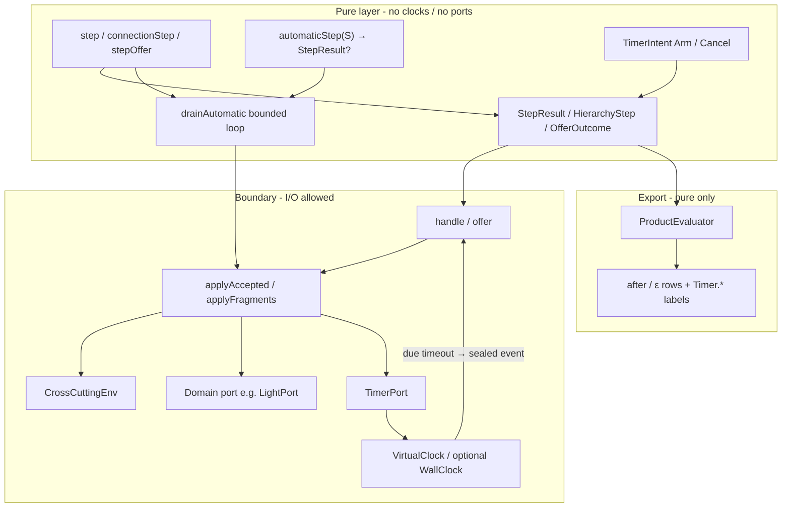
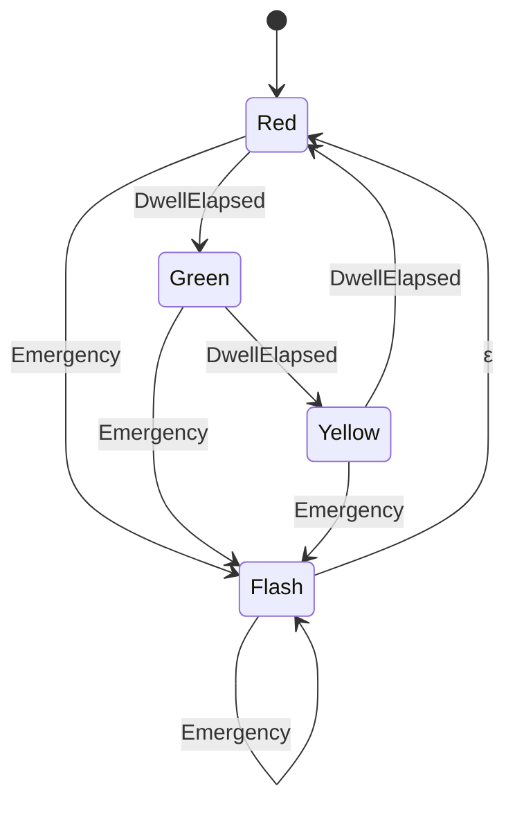

# Timers and Automatic (Completion) Transitions for Pure-Step FSMs

| Field | Value |
|-------|--------|
| **Author** | TBD (sample design; no single owner assigned) |
| **Date** | 2026-07-27 |
| **Status** | Accepted (PRs 1–5 shipped; this doc is the authoring guide) |
| **Workspace** | `/Users/bstiles/Scratch/fsm` |
| **Branch tip** | timers + automatic drain + TrafficLight Flash/dwell + Connection watchdog |
| **Audience** | Senior engineers and coding agents extending this sample |
| **Related** | [`docs/machine-authoring-surfaces.md`](docs/machine-authoring-surfaces.md) — **do not rewrite**; this design **extends** shared surfaces |

**Shipped (PRs 1–6 + residuals):** Timers (`TimerIntent` + `VirtualClock`/`TimerPort`), `drainAutomatic`, TrafficLight dwell + Flash→Red ε, Connection Online watchdog, and vignette `fireDueTimeouts()` helpers are **in-tree**. Prefer the README kind matrix + Appendix A for day-to-day authoring.

**As-built must-match (do not reintroduce):**
- Inject only `clock`; own `val timers = TimerPort(clock)` — never a separate constructor-injected `TimerPort`.
- Multi-port apply via lambdas `{ domain, _ -> applyDomain*(domain, port, timers) }` — no ignored-port private wrappers.
- No `applyTimerIntents` free function; use `TimerPort.apply(list)` / `apply(single)`.
- Client recipe: `clock.advance` → `pollDue` / optional `fireDueTimeouts()` on TrafficLight **and** ConnectionContext.

Sketch snippets below may lag; when they conflict with this banner or with source under `src/`, **source wins**.

---

## Overview

The sample teaches four pure-step machine kinds (flat total, CSP partial, hierarchical, orthogonal) with dual-sink declare → boundary apply, product export over pure APIs only, and no third-party FSM engine. **As shipped**, it also teaches:

1. **Timer / delayed transitions** — pure domain `TimerIntent` (Arm/Cancel), boundary `TimerPort` + `VirtualClock`, timeout re-entry as sealed events (`DwellElapsed`, `WatchdogTimeout`). External `Tick` / `Heartbeat` remain client-supplied teaching events (K14 / K15).
2. **Automatic / eventless / completion transitions** — pure `automaticStep(S) → StepResult?` + boundary `drainAutomatic` after each external apply (TrafficLight Flash→Red ε). No public `Completion` alphabet pollution.

Both capabilities are **ordinary Kotlin** extensions of the dual-sink model: pure code **declares** arm/cancel and completion outcomes; boundaries **schedule** wall time and **drain** bounded automatic microsteps; product export **labels** `after` / `ε` edges without running clocks. No SCXML interpreter, no third-party engine, no abandonment of pure declare → boundary apply.

**Revision 2** fully specifies Flash × event total-step policy, dwell cancel on every color-changing path (no dangling timers), multi-port applyDomain lambdas (still one domain list), inline timer apply order, eventKey mappers, `drainAutomatic` throw-only shape, and expanded PR regression surfaces.

---

## Background & Motivation

### Pre-implementation baseline (historical — not live truth)

Before PRs 1–5, the sample had no timer or automatic surfaces. The table below is the **gap that motivated this design**; for as-built code, see README + vignettes (`LightEffect.Timer`, Flash/ε, Online Arm/Cancel).

| Kind | Sample | Pure surface | Boundary | Notes on “time” / completion **(pre-PR)** |
|------|--------|--------------|----------|------------------------------|
| Flat total | [`flat/TrafficLight.kt`](src/main/kotlin/fsm/sample/flat/TrafficLight.kt) | `step(S,E) → StepResult` | `applyAccepted` | `LightEvent.Tick` client-supplied only; **no** arm/cancel yet |
| CSP partial | [`csp/FileProtocol.kt`](src/main/kotlin/fsm/sample/csp/FileProtocol.kt) | `stepOffer → OfferOutcome` | `applyOffer` | Menus; no final/done completion |
| Hierarchical | [`gof/ConnectionMachine.kt`](src/main/kotlin/fsm/sample/gof/ConnectionMachine.kt) | `connectionStep → HierarchyStep` | `applyFragments` then assign | `ConnEvent.Heartbeat` external; Online enter/exit domain only (`OpenSession`/`CloseSession`); **no** watchdog yet |
| Orthogonal | [`orthogonal/DoorSystem.kt`](src/main/kotlin/fsm/sample/orthogonal/DoorSystem.kt) | Region `step` + container guards | `applyAccepted` / `applyRefusal` | No region-done / `done.state` |

Shared dual-sink outcomes:

```text
StepResult(next, crossCutting: List<CrossCuttingEffect>, domain: List<D>)
OfferOutcome.Accepted(next, crossCutting, domain) | Refused(reason, next, crossCutting)
HierarchyStep.Handled(next, effects: FragmentedStepEffects<D>) | Unhandled(effects)
```

Cross-cutting families today ([`effect/CrossCuttingEffect.kt`](src/main/kotlin/fsm/sample/effect/CrossCuttingEffect.kt)): **Audit / Metric / Trace** only → [`CrossCuttingEnv`](src/main/kotlin/fsm/sample/effect/CrossCuttingEnv.kt). Domain ADTs stay vignette-local (`LightEffect`, `ConnectionEffect`, …) → vignette ports (often subclassing [`RecordingPort`](src/main/kotlin/fsm/sample/machine/RecordingPort.kt)).

Boundary families ([`machine/BoundaryApply.kt`](src/main/kotlin/fsm/sample/machine/BoundaryApply.kt)):

| Family | Helper | Assign vs apply |
|--------|--------|-----------------|
| Total / offer | `applyAccepted` / `applyOffer` | Assign **first**, then CC, then domain |
| Guard refuse | `applyRefusal` | CC only |
| Hierarchical | `applyFragments` | Apply per fragment **first**, caller assigns leaf after |

Product export ([`export/ProductEvaluator.kt`](src/main/kotlin/fsm/sample/export/ProductEvaluator.kt)) enumerates sealed domains via pure step callbacks only—never `handle`, never real clocks, never `ConnectionContext` (init runs entry effects).

### Pain points / industry gap

| Industry feature | Sample today | Pain |
|------------------|--------------|------|
| SCXML `<send delay="…">` / cancel | Absent | Agents invent ad-hoc `Thread.sleep` or fold delays into client drivers |
| UML `after(t)` / Rhapsody timeout | Absent | No cancel-on-exit recipe for hierarchical LCA exit |
| Eventless / completion transitions | Absent | Every micro-change requires a synthetic client event (`Tick`) |
| Final + `done.state.X` | Absent | Orthogonal “all regions done” not expressible as pure completion |
| Export of timed edges | N/A | Would require impure clocks if implemented naively |

### Why this matters for didactic quality

Agents and humans copy vignettes. Without a **canonical pure-declare / boundary-schedule** recipe, the next machine will either:

- call `Thread.sleep` inside `step` (breaks purity + export), or
- invent a third-party scheduler library, or
- stuff timers into `CrossCuttingEffect` (conflates observability with I/O scheduling), or
- add a third list on `StepResult` because a second port appears at the boundary (**multi-port fan-out of one domain sink is not a third outcome field** — see K13).

The same risk applies to automatic transitions: unbounded re-step loops, product tables that miss `ε` edges, or synthetic events that pollute every Cartesian product cell.

---

## Goals & Non-Goals

### Goals

1. **Timers (high value):** Pure code declares **arm / cancel** intents; a boundary **TimerPort** schedules virtual or wall time; timeouts **re-enter** as ordinary sealed events; **cancel-on-exit** works with hierarchical `applyFragments` / LCA exit; **cancel on every color-changing flat path** so no dangling dwell.
2. **Automatic / completion transitions (high value):** After an accepted external step, a **bounded pure microstep loop** drains eventless edges without requiring the client to inject a dummy event.
3. Preserve **pure declare → boundary apply** dual-sink discipline and both assign-order families.
4. Keep **product export pure**: label `after` / `ε` edges from declarations only—no clocks, no ports, no context init.
5. Fit existing packages: `effect/`, `machine/`, vignettes, `export/`, README kind matrix.
6. Teach with **copyable recipes** on existing or lightly extended vignettes (not a full second product).
7. Deterministic tests via **fake / virtual clock**.
8. **Total-machine exhaustiveness:** every sealed state × event (including Flash) has a pure `step` definition for product export.

### Non-Goals (v1 — explicit)

1. **No third-party FSM/statechart engine** (Spring Statemachine, XState, SCXML runtime, etc.).
2. **No full SCXML interpreter** — no internal event queue + run-to-completion (RTC) graph walker as the core product model.
3. **No history** (shallow/deep) as a shared surface.
4. **No deferred-event queues** (UML defer / SCXML event-queue reorder).
5. **No orthogonal `done.state.*` / all-regions-done** completion protocol (call out as follow-up).
6. **No real wall-clock requirement** for correctness of the sample—virtual clock is sufficient; optional real scheduler is demo-only.
7. **No third cross-cutting family** that folds scheduling into Audit/Metric/Trace.
8. **No rewrite** of [`docs/machine-authoring-surfaces.md`](docs/machine-authoring-surfaces.md); extend via pointer + this doc + README matrix rows.
9. **No global domain Effect ADT** mixing lamp, file, session, door, and timer as one sealed root used by all machines.
10. **No third list field** on `StepResult` / `OfferOutcome` / `HierarchyStep` / fragments (multi-port domain apply is not a third field).
11. **No dwell arm on TrafficLight construction** — initial Red is idle until first engagement (see §6).
12. **No hierarchical automatic drain / Connection completion leaf in v1** — shared helper is generic; wiring deferred (see §4 Hierarchy, PR 2).

### Secondary (decide in/out — v1 decision)

| Topic | v1 decision | Rationale |
|-------|-------------|-----------|
| History | **Out** | Orthogonal to timers/automatic; large hierarchy surface |
| Deferred events | **Out** | Needs queues; conflicts with “no full RTC interpreter” |
| Full RTC interpreter | **Out** | Hard constraint |
| Final states + `done.state` (flat single final) | **Partial in** only if automatic completion is the teaching vehicle (completion is pure `automaticStep`, not a public alphabet event) | Cheap if automatic API exists |
| Orthogonal all-regions-done | **Out** | Needs multi-region join protocol |
| Hierarchical automatic microsteps | **Helper in; vignette wiring out** | PR 2 ships generic `drainAutomatic`; Connection does not call it until a completion leaf exists |
| Hierarchical timers (cancel on LCA exit) | **In** | Primary reason Connection exit domain exists as a pattern |
| Init-time Red dwell arm | **Out** | Avoid flat enterEffects scope creep; first engagement arms next color |
| Keep Tick + DwellElapsed | **Locked in** | External-event teaching + timer re-entry |
| Absolute Online watchdog (no Heartbeat re-arm) | **Locked in** | Simpler tests; refresh is a follow-up policy |

---

## Proposed Design

### Design principles

1. **Declare vs apply remains sacred.** Pure functions never touch clocks, `TimerPort`, or real schedulers.
2. **Timers are domain-like scheduling intents**, not observability. They must **not** become a fourth `CrossCuttingEffect` family.
3. **Timeouts re-enter as sealed events** the machine already (or newly) accepts—same `step` / `connectionStep` path as client events.
4. **Automatic transitions are pure re-steps**, not a second interpreter. Bound microsteps; detect cycles; **throw on bound/cycle** (no soft `truncated` flag).
5. **Export reads declarations only** — `Timer.Arm(…)` / `Timer.Cancel(…)` labels and `ε` / `after(…)` event strings.
6. **Kind-specific cores stay kind-specific.** Flat keeps `StepResult`; hierarchy keeps fragments + apply-then-assign.
7. **Agent-friendly defaults:** shared helpers for drain + timer ADT/port; vignette policy (which states arm which timers) stays local.
8. **One domain list, N ports at apply** — never invent `StepResult.timers`.
9. **Domain list order is load-bearing** — apply effects **inline** in list order (including timer intents).

### Architecture



### Package placement

| Artifact | Package | Rationale |
|----------|---------|-----------|
| `TimerIntent` (Arm / Cancel) | `fsm.sample.effect` | Pure declaration vocabulary, peer of factories—not an engine |
| `TimerPort`, `VirtualClock`, `ScheduledTimeout` | `fsm.sample.machine` | Boundary scheduling; same home as `RecordingPort` / apply helpers |
| `drainAutomatic` / `AutomaticDrainResult` | `fsm.sample.machine` | Boundary-adjacent pure control flow used by handles (still pure if given pure step lambdas) |
| `automaticStep` / vignette timeout events / eventKey mappers | vignette packages | Machine-specific policy |
| Product helpers for `ε` / `after` rows | `fsm.sample.export` | Extends product evaluation only |
| Docs | `docs/timers-and-automatic-transitions.md` (+ README pointer) | Extends authoring surfaces; does not rewrite them |

**Why not put `TimerIntent` under `CrossCuttingEffect`?**

Cross-cutting is multi-family **observability** (audit / metrics / trace) applied to `CrossCuttingEnv`. Timers are **scheduling I/O**: they mutate a scheduler and later inject events. Folding them into CC would force `CrossCuttingInterpreter` to own clocks, break the “export labels without side effects” story for CC-only refuse paths, and teach the wrong abstraction.

**Why not a mandatory third field on every `StepResult`?**

```kotlin
// REJECTED as required shape for all machines
data class StepResult<S, D>(
    val next: S,
    val crossCutting: List<CrossCuttingEffect>,
    val domain: List<D>,
    val timers: List<TimerIntent>, // forces every total machine to care
)
```

Most machines (FileProtocol, Door regions today) need no timers. A third list on the universal outcome type is a breaking teaching change and invites agents to treat timers as always-present.

**Chosen approach: timers live in the domain sink (domain union), with a shared `TimerIntent` type and shared port recipe.**

```text
ONE domain list on StepResult / fragments
        │
        ▼
  applyDomain*(domain, hardwarePort, timerPort)
        │
        ├── DriveLamp / OpenSession / …  →  hardware port
        └── Timer(Arm|Cancel)            →  TimerPort   (INLINE, list order)
```

This is **multi-port fan-out of one sink**, not a third outcome field (K13).

**v1 recommendation: Option B for TrafficLight and Connection** — vignette sealed domain includes hardware cases + `Timer(TimerIntent)`; dual-sink pure shape unchanged.

---

### Concrete answers to design questions

#### 1. Where do timer intents live?

| Option | Pros | Cons | v1 |
|--------|------|------|----|
| Domain ADT cases (machine-local, may embed shared `TimerIntent`) | Dual-sink preserved; export labels via existing domain path; cancel-on-exit = exit domain | Each machine routes timer cases in `applyDomain*` | **Yes — primary** |
| New `CrossCuttingEffect.Timer` family | Shared interpreter | Wrong semantics; clocks in CC env; refuse paths weird | **No** |
| Third list on `StepResult` / fragments | Explicit | Breaks dual-sink teaching; churn on all kinds | **No (v1)** |
| Shared-only `TimerIntent` as entire domain `D` | Clean for timer-only toys | Forces hardware into second port without a typed domain union | Optional for a pure timer vignette only |

**Shared type (pure declaration):**

```kotlin
// effect/TimerIntent.kt
package fsm.sample.effect

/**
 * PURPOSE: Pure delayed-send intents — domain-like scheduling, not cross-cutting observability.
 * Pure steps declare; boundaries apply via [fsm.sample.machine.TimerPort].
 * Export labels only — never constructs clocks.
 *
 * [Arm.eventKey] MUST equal the vignette sealed event's [label] (see eventKey recipe).
 */
sealed class TimerIntent {
    /**
     * Arm (or replace) a named timer. When [delayMs] elapses on the boundary clock,
     * the port delivers [eventKey] for re-entry as a sealed machine event.
     */
    data class Arm(
        val id: String,
        val delayMs: Long,
        val eventKey: String,
    ) : TimerIntent() {
        fun exportLabel(): String = "Timer.Arm($id,${delayMs}ms,$eventKey)"
    }

    /** Cancel a previously armed timer if still pending. Idempotent at the port. */
    data class Cancel(val id: String) : TimerIntent() {
        fun exportLabel(): String = "Timer.Cancel($id)"
    }
}

fun TimerIntent.exportLabel(): String = when (this) {
    is TimerIntent.Arm -> exportLabel()
    is TimerIntent.Cancel -> exportLabel()
}
```

**TrafficLight domain extension:**

```kotlin
// flat/LightEffect.kt — extended
sealed class LightEffect {
    data class DriveLamp(val colorLabel: String) : LightEffect()
    /** Domain scheduling intent — applied to TimerPort, not LightPort. */
    data class Timer(val intent: TimerIntent) : LightEffect()
}

fun LightEffect.exportLabel(): String = when (this) {
    is LightEffect.DriveLamp -> "DriveLamp($colorLabel)"
    is LightEffect.Timer -> intent.exportLabel()
}

/** Single dwell timer id for this machine (teaching default: one id per machine). */
const val LIGHT_DWELL_ID = "light.dwell"

/** Dwell delays (ms) — pure constants, not read from a clock. */
const val DWELL_RED_MS = 30_000L
const val DWELL_GREEN_MS = 25_000L
const val DWELL_YELLOW_MS = 5_000L

fun dwellMsFor(state: LightState): Long? = when (state) {
    LightState.Red -> DWELL_RED_MS
    LightState.Green -> DWELL_GREEN_MS
    LightState.Yellow -> DWELL_YELLOW_MS
    LightState.Flash -> null // no dwell while flashing; automaticStep owns exit
}
```

**Connection enter/exit domain (list order is load-bearing — Cancel before CloseSession):**

```kotlin
// Online.exitEffects domain — Cancel FIRST, then CloseSession (inline apply preserves order)
domain = listOf(
    ConnectionEffect.Timer(TimerIntent.Cancel(CONNECTION_WATCHDOG_ID)),
    ConnectionEffect.CloseSession,
)

// Online.enterEffects domain — OpenSession then Arm (or Arm then OpenSession; both fine if inline)
domain = listOf(
    ConnectionEffect.OpenSession,
    ConnectionEffect.Timer(
        TimerIntent.Arm(
            id = CONNECTION_WATCHDOG_ID,
            delayMs = 30_000L,
            eventKey = ConnEvent.WatchdogTimeout.label(), // MUST use label()
        ),
    ),
)

const val CONNECTION_WATCHDOG_ID = "connection.online.watchdog"
```

#### 2. Port shape for scheduling (fake deterministic clock)

```kotlin
// machine/TimerPort.kt
package fsm.sample.machine

import fsm.sample.effect.TimerIntent

/** One pending delayed delivery. */
data class ScheduledTimeout(
    val id: String,
    val dueAtMs: Long,
    val eventKey: String,
)

/**
 * PURPOSE: Boundary scheduler for [TimerIntent] — not an FSM engine.
 * [VirtualClock] is the test/demo default; wall clock is optional demo-only.
 */
interface Clock {
    /** Monotonic sample time in milliseconds (virtual or wall). */
    fun nowMs(): Long
}

/** Deterministic clock for tests and pure demos. */
class VirtualClock(startMs: Long = 0L) : Clock {
    private var now: Long = startMs
    override fun nowMs(): Long = now
    fun advance(deltaMs: Long) {
        require(deltaMs >= 0)
        now += deltaMs
    }
}

/**
 * PURPOSE: In-memory timer bag. Applies Arm/Cancel; exposes due timeouts.
 * Does not call machine.handle — the boundary drains due events explicitly
 * so re-entry stays a sealed event through the normal pure step path.
 *
 * Teaching default: one timer id per machine (`light.dwell`, `connection.online.watchdog`).
 * Multi-id is supported; [pollDue] returns due entries sorted by (dueAtMs, id).
 */
class TimerPort(private val clock: Clock = VirtualClock()) {
    private val pending = linkedMapOf<String, ScheduledTimeout>()

    fun apply(intents: List<TimerIntent>) {
        for (intent in intents) {
            when (intent) {
                is TimerIntent.Arm -> {
                    pending[intent.id] = ScheduledTimeout(
                        id = intent.id,
                        dueAtMs = clock.nowMs() + intent.delayMs,
                        eventKey = intent.eventKey,
                    )
                }
                is TimerIntent.Cancel -> pending.remove(intent.id)
            }
        }
    }

    fun pending(): List<ScheduledTimeout> = pending.values.toList()

    /**
     * Remove and return all timeouts with dueAtMs <= now.
     * Order: sorted by (dueAtMs ascending, id ascending) — not insertion order.
     * Caller maps eventKey → sealed event via vignette mapper and calls handle.
     */
    fun pollDue(): List<ScheduledTimeout> {
        val now = clock.nowMs()
        val due = pending.values
            .filter { it.dueAtMs <= now }
            .sortedWith(compareBy({ it.dueAtMs }, { it.id }))
        due.forEach { pending.remove(it.id) }
        return due
    }

    /** Single-intent convenience for multi-port domain apply loops. */
    fun apply(intent: TimerIntent) = apply(listOf(intent))

    fun clear() = pending.clear()
}

// As-built: no free-function applyTimerIntents — call TimerPort.apply directly.
```

##### eventKey mapping recipe (required)

| Rule | Detail |
|------|--------|
| **Arm with label()** | `TimerIntent.Arm(..., eventKey = LightEvent.DwellElapsed.label())` — never a freehand string that can drift from `label()` |
| **Pure mapper per vignette** | Explicit `when` — **no reflection** |
| **Unknown key** | Mapper returns `null` or throws in tests; boundary must not silently drop |

```kotlin
// flat — pure mapper
fun lightEventFromTimerKey(eventKey: String): LightEvent? = when (eventKey) {
    LightEvent.DwellElapsed.label() -> LightEvent.DwellElapsed
    else -> null
}

// gof — pure mapper
fun connEventFromTimerKey(eventKey: String): ConnEvent? = when (eventKey) {
    ConnEvent.WatchdogTimeout.label() -> ConnEvent.WatchdogTimeout
    else -> null
}

// Test / demo drain recipe — vignette methods (TrafficLight and ConnectionContext both own this)
// Shared recipe: pollDue → pure mapper → handle. Not used by product export.
fun TrafficLight.fireDueTimeouts(): List<LightEvent> { /* pollDue → lightEventFromTimerKey → handle */ }
fun ConnectionContext.fireDueTimeouts(): List<ConnEvent> { /* pollDue → connEventFromTimerKey → handle */ }
```

**Must not:** start threads inside pure `step`; call `pollDue` from product export; auto-fire from `apply` without an explicit boundary drain; invent ad-hoc string keys not equal to `label()`.

**Optional demo:** `WallClock : Clock` + a single-threaded scheduled executor that enqueues eventKeys onto a client queue—**DemoMain only**, not required for tests or export. DemoMain shows VirtualClock advance + `fireDueTimeouts` (TrafficLight dwell + Connection watchdog), not wall threads as the primary path.

#### 3. Cancel-on-exit with hierarchical `applyFragments` / LCA

Existing [`planTransition`](src/main/kotlin/fsm/sample/machine/Hierarchy.kt) order:

```text
exit (innermost → outermost, exclusive of LCA)
  → transition audit fragment (+ transitionExtras)
  → handler domain
  → enter (outermost → innermost, exclusive of LCA)
```

[`applyFragments`](src/main/kotlin/fsm/sample/machine/BoundaryApply.kt) applies each fragment (CC then domain) **while the leaf is still the old state**, then the caller assigns.

**Cancel-on-exit recipe (no Hierarchy.kt change required for v1):**

1. State `exitEffects` declare `TimerIntent.Cancel(id)` as domain **first** in the domain list (then CloseSession).
2. State `enterEffects` declare `TimerIntent.Arm(id, delay, eventKey)` as domain (with OpenSession).
3. Same-leaf reactions (e.g. Heartbeat) must **not** cancel/re-arm — absolute deadline from Online enter (**locked**, K15).
4. Idle ↔ Transferring (LCA = Online): Online exit/enter **do not run** → watchdog remains armed.
5. Idle → Offline: Online exit runs → Cancel then CloseSession (inline order).

```mermaid
sequenceDiagram
  participant Client
  participant Ctx as ConnectionContext
  participant Pure as connectionStep
  participant Apply as applyFragments
  participant TP as TimerPort
  participant Port as ConnectionPort

  Client->>Ctx: handle(Disconnect)
  Ctx->>Pure: connectionStep(Idle, Disconnect)
  Pure-->>Ctx: Handled(Offline, fragments)
  Note over Pure: exit Idle; exit Online domain Cancel then CloseSession; transition; enter Offline
  Ctx->>Apply: applyFragments while current=Idle
  Apply->>TP: Cancel(watchdog)
  Apply->>Port: CloseSession
  Ctx->>Ctx: current = Offline
```

**Risk:** If agents put Cancel only in handler domain (not exit), Offline may leave a dangling timer. **Mitigation:** Connection test: after Disconnect, `timers.pending()` empty; after StartTransfer, watchdog still pending.

##### Multi-port applyDomain — **inline** list order (chosen)

**Decision (Issue 4):** Apply timer intents **inline** in domain list order—same sequential style as today’s `applyDomainLight` loop. Do **not** batch all timers after session ops (that would ignore author order and contradict “Cancel before CloseSession”).

```kotlin
// gof/ConnectionEffect.kt — domain apply fans out to two ports, ONE domain list
fun applyDomainConnection(
    domain: List<ConnectionEffect>,
    port: ConnectionPort,
    timers: TimerPort,
) {
    for (effect in domain) {
        when (effect) {
            ConnectionEffect.IncHeartbeat -> port.incHeartbeat()
            ConnectionEffect.OpenSession -> port.record(SessionOp.Opened)
            ConnectionEffect.CloseSession -> port.record(SessionOp.Closed)
            is ConnectionEffect.Timer -> timers.apply(listOf(effect.intent)) // INLINE
        }
    }
}

// flat/LightEffect.kt
fun applyDomainLight(
    domain: List<LightEffect>,
    port: LightPort,
    timers: TimerPort,
) {
    for (effect in domain) {
        when (effect) {
            is LightEffect.DriveLamp -> port.drive(effect.colorLabel)
            is LightEffect.Timer -> timers.apply(effect.intent) // INLINE single-intent
        }
    }
}
```

##### Canonical boundary call sites (as-built)

`applyAccepted` / `applyFragments` keep signature `(List<D>, P) -> Unit`. **Never** pass bare two-arg `::applyDomainLight`. **Inject only `clock`**; own `val timers = TimerPort(clock)` as a property (never a separate constructor-injected port).

```kotlin
// --- TrafficLight (flat total) ---
class TrafficLight(
    initial: LightState = LightState.Red,
    val crossCutting: CrossCuttingEnv = CrossCuttingEnv(),
    val port: LightPort = LightPort(),
    val clock: VirtualClock = VirtualClock(),
    private val machineName: String = "TrafficLight",
) {
    val timers: TimerPort = TimerPort(clock) // always from clock
    var current: LightState = initial
        private set

    fun handle(event: LightEvent): LightState {
        // Multi-port: P required by applyAccepted; unused when fan-out closes over fields.
        val applyDomain: (List<LightEffect>, LightPort) -> Unit =
            { domain, _ -> applyDomainLight(domain, port, timers) }
        val result = step(current, event, machineName)
        applyAccepted(result, crossCutting, port, applyDomain) { current = it }
        val drain = drainAutomatic(
            start = current,
            automaticStep = { s -> automaticStep(s, machineName) },
            nextOf = { it.next },
        )
        for (micro in drain.microsteps) {
            applyAccepted(micro, crossCutting, port, applyDomain) { current = it }
        }
        return current
    }

    fun fireDueTimeouts(): List<LightEvent> { /* pollDue → lightEventFromTimerKey → handle */ }
}

// --- ConnectionContext (hierarchy) — same clock ownership ---
class ConnectionContext(
    // ...
    val clock: VirtualClock = VirtualClock(),
    // NO timers constructor param
) {
    val timers: TimerPort = TimerPort(clock)

    init {
        val effects = pathFromRoot(initial) { it.parent }
            .fold(FragmentedStepEffects<ConnectionEffect>()) { acc, s ->
                acc + s.enterEffects(machineName)
            }
        applyFragments(effects, crossCutting, port) { domain, _ ->
            applyDomainConnection(domain, port, timers)
        }
    }

    fun handle(event: ConnEvent): Boolean {
        val fromLeaf = current
        val step = connectionStep(fromLeaf, event, machineName)
        applyFragments(step.effects, crossCutting, port) { domain, _ ->
            applyDomainConnection(domain, port, timers)
        }
        return when (step) {
            is HierarchyStep.Handled -> {
                if (step.next !== fromLeaf) current = step.next
                true
            }
            is HierarchyStep.Unhandled -> false
        }
    }

    fun fireDueTimeouts(): List<ConnEvent> { /* pollDue → connEventFromTimerKey → handle */ }
}
```

**Do not** invent a shared multi-port apply framework or change `applyAccepted` generics. **Do** document: domain list may fan out to multiple ports; never add a third list on outcomes (K13).

#### 4. Automatic transitions: synthetic sealed event vs separate pure API

| Approach | Pros | Cons | v1 |
|----------|------|------|----|
| Synthetic `Completion` / `NullEvent` in every alphabet | One `step(S,E)` | Pollutes product Cartesian product; every state×Completion row | **No as public alphabet member** |
| Separate pure `automaticStep(S) → StepResult?` | Product can query per-state; no alphabet pollution | Second pure function to maintain | **Yes — primary** |
| Encode eventless inside `step` via optional event | Confusing overloads | Breaks sealed exhaustiveness culture | **No** |

**Chosen — throw-only drain (no `truncated` field):**

```kotlin
// machine/Automatic.kt
package fsm.sample.machine

/**
 * PURPOSE: Pure bounded drain of eventless / completion transitions.
 * [automaticStep] returns null when no eventless edge is enabled from [state].
 * Does not apply sinks — caller applies each microstep result.
 *
 * Bound / cycle policy: ALWAYS throw [AutomaticBoundExceededException].
 * No soft truncated flag — fail loud in the sample (K7).
 */
data class AutomaticDrainResult<S, R>(
    val finalState: S,
    /** Ordered pure results of each microstep (not including the external event that preceded drain). */
    val microsteps: List<R>,
)

class AutomaticBoundExceededException(
    message: String,
    val stepsTaken: Int,
    val reason: Reason,
) : IllegalStateException(message) {
    enum class Reason { BOUND, CYCLE }
}

fun <S, R> drainAutomatic(
    start: S,
    automaticStep: (S) -> R?,
    nextOf: (R) -> S,
    detectCycles: Boolean = true,
    maxMicrosteps: Int = DEFAULT_MAX_MICROSTEPS,
): AutomaticDrainResult<S, R> {
    val microsteps = mutableListOf<R>()
    val seen = linkedSetOf(start)
    var current = start
    repeat(maxMicrosteps) {
        val step = automaticStep(current)
            ?: return AutomaticDrainResult(current, microsteps)
        val next = nextOf(step)
        microsteps += step
        if (detectCycles && next in seen) {
            throw AutomaticBoundExceededException(
                "automatic cycle detected at state=$next after ${microsteps.size} microsteps",
                stepsTaken = microsteps.size,
                reason = AutomaticBoundExceededException.Reason.CYCLE,
            )
        }
        seen += next
        current = next
    }
    if (automaticStep(current) != null) {
        throw AutomaticBoundExceededException(
            "automatic microstep bound $maxMicrosteps exceeded",
            stepsTaken = microsteps.size,
            reason = AutomaticBoundExceededException.Reason.BOUND,
        )
    }
    return AutomaticDrainResult(current, microsteps)
}

const val DEFAULT_MAX_MICROSTEPS: Int = 32
```

**Why apply external first, then drain?** Matches UML/Rhapsody RTC intuition at the *handle* boundary without building an internal event queue: one external engagement, then completion microsteps until quiescent (or throw).

##### Hierarchy automatic — v1 scope

| Item | v1 |
|------|----|
| Generic `drainAutomatic` | **In** (PR 2) — fixtures use flat-shaped `StepResult` only |
| Connection `automaticConnectionStep` | **Out** — no completion leaf |
| Connection `handle` drain | **Out** |
| Connection `init` drain | **Out** (Open Q4 locked: deferred) |

**Follow-up pseudocode** (do not implement in v1; for agents who copy drain onto hierarchy early):

```kotlin
// ONLY when a pure automaticConnectionStep exists returning HierarchyStep.Handled?
fun ConnectionContext.handleWithAutomatic(event: ConnEvent): Boolean {
    val accepted = handle(event) // existing applyFragments + assign
    // Drain only Handled microsteps; Unhandled must not appear from automaticStep
    val drain = drainAutomatic(
        start = current,
        automaticStep = { leaf ->
            when (val a = automaticConnectionStep(leaf, machineName)) {
                is HierarchyStep.Handled -> a
                is HierarchyStep.Unhandled, null -> null
            }
        },
        nextOf = { it.next },
    )
    for (micro in drain.microsteps) {
        applyFragments(micro.effects, crossCutting, port, ::applyDomain)
        if (micro.next !== current) current = micro.next
    }
    return accepted
}
```

**CSP / offer:** FileProtocol stays menu-driven without `ε` in v1.

#### 5. Microstep bound and cycle detection

| Parameter | Default | Behavior |
|-----------|---------|----------|
| `maxMicrosteps` | **32** | Throws `AutomaticBoundExceededException(BOUND)` if an edge remains enabled after 32 steps |
| `detectCycles` | **true** | Throws `AutomaticBoundExceededException(CYCLE)` if `next` already seen |
| Soft truncate | **None** | No `truncated` field; boundary does not return partial-success for bound |
| Export | N/A | Product evaluates **one** `automaticStep(s)` per state — not `drainAutomatic` |

**Tests (PR 2):** empty drain; single hop; multi-hop; cycle throw; bound throw (40-hop fixture).

#### 6. Which vignette(s) teach each feature

| Feature | Primary vignette | Secondary | Why |
|---------|------------------|-----------|-----|
| **Timers (arm + timeout + cancel)** | **TrafficLight** | — | Flat total; simplest recipe |
| **Timers + cancel-on-exit (hierarchy)** | **Connection** | — | LCA exit domain pairing |
| **Automatic / completion** | **TrafficLight** Flash → ε → Red | — | Same machine; Door/File free of noise |
| Orthogonal timers / done.state | **Out of v1** | Future Door | Needs join protocol |

##### TrafficLight storyboard (normative)

1. **Keep Tick** as manual external advance (**locked**, K14).
2. **Dwell timers:** on every transition **into** a dwell color (Red/Green/Yellow), pure `step` domain includes `Cancel(LIGHT_DWELL_ID)` then `Arm(LIGHT_DWELL_ID, dwellMs, DwellElapsed.label())` plus `DriveLamp`. Teaching default: **one timer id** `light.dwell`.
3. **`LightEvent.DwellElapsed`** advances color like Tick (same next-state table).
4. **Automatic:** `Emergency` → `Flash`; pure `automaticStep(Flash)` → `Red` with event label `ε`.
5. **No arm on construction** — machine starts Red with **empty** `timers.pending()` until first engagement (**non-goal**, K16). First Tick/DwellElapsed/Emergency arms (or cancels) as per the policy tables below.
6. Emergency extras use **“emergency interrupt”** / next label Flash — not the legacy “forced Red” copy (Issue 13).

##### Normative dwell delays

| State entered | Arm delayMs |
|---------------|-------------|
| Red | 30_000 |
| Green | 25_000 |
| Yellow | 5_000 |
| Flash | *none* (no dwell) |

---

### Flash × event total-step policy (normative — Issue 1)

TrafficLight remains a **total** machine. `productEvaluateTotal` enumerates **every** state × event via pure `step(S,E)`. Flash is a **stable pure state** in the sealed hierarchy and **must** appear in `evaluateTrafficLight` states. Handle still drains `ε` so live runs often leave Flash only ephemerally; **product rows still include full Flash Cartesian**.

#### States and events after PR 4

| Sealed set | Members |
|------------|---------|
| `LightState` | Red, Green, Yellow, **Flash** |
| `LightEvent` | Tick, Emergency, **DwellElapsed** |

#### `transition(state, event)` next-state table

| From \ Event | Tick | DwellElapsed | Emergency |
|--------------|------|--------------|-----------|
| **Red** | Green | Green | **Flash** |
| **Green** | Yellow | Yellow | **Flash** |
| **Yellow** | Red | Red | **Flash** |
| **Flash** | Flash (self) | Flash (self) | Flash (self) |

Rationale for Flash self-loops on external events: Flash is only exited by **eventless** `automaticStep`. Client Tick/DwellElapsed/Emergency while flashing are total no-ops on next-state (still **accepted** engagements with audit + cancel safety — see domain table). Product shows honest ACCEPTED self-rows; live `handle(Emergency)` applies Flash step then drain → Red.

#### Domain + CC policy per edge (Issue 2 — no dangling dwell)

Helpers (pure, vignette-local):

```kotlin
fun cancelDwell(): LightEffect = LightEffect.Timer(TimerIntent.Cancel(LIGHT_DWELL_ID))

fun armDwell(forState: LightState): LightEffect {
    val ms = dwellMsFor(forState) ?: error("no dwell for $forState")
    return LightEffect.Timer(
        TimerIntent.Arm(LIGHT_DWELL_ID, ms, LightEvent.DwellElapsed.label()),
    )
}

/** Domain for entering a dwell color: always Cancel then Arm then DriveLamp. */
fun domainEnterDwellColor(color: LightState): List<LightEffect> = listOf(
    cancelDwell(),
    armDwell(color),
    LightEffect.DriveLamp(color.label()),
)

/** Domain for entering Flash: Cancel dwell (idempotent); DriveLamp Flash; no Arm. */
fun domainEnterFlash(): List<LightEffect> = listOf(
    cancelDwell(),
    LightEffect.DriveLamp(LightState.Flash.label()),
)
```

| From | Event | Next | Domain (ordered) | CC extras (beyond accept preamble) |
|------|-------|------|------------------|--------------------------------------|
| Red | Tick | Green | Cancel, Arm(Green), DriveLamp(Green) | `light.ticks` |
| Red | DwellElapsed | Green | Cancel, Arm(Green), DriveLamp(Green) | `light.ticks` (or `timer.fire` + ticks — pick one in impl; default **ticks** for parity with Tick) |
| Red | Emergency | Flash | Cancel, DriveLamp(Flash) | `traceSpan("light.emergency", "emergency interrupt → Flash")` |
| Green | Tick | Yellow | Cancel, Arm(Yellow), DriveLamp(Yellow) | `light.ticks` |
| Green | DwellElapsed | Yellow | Cancel, Arm(Yellow), DriveLamp(Yellow) | `light.ticks` |
| Green | Emergency | Flash | Cancel, DriveLamp(Flash) | emergency interrupt → Flash |
| Yellow | Tick | Red | Cancel, Arm(Red), DriveLamp(Red) | `light.ticks` |
| Yellow | DwellElapsed | Red | Cancel, Arm(Red), DriveLamp(Red) | `light.ticks` |
| Yellow | Emergency | Flash | Cancel, DriveLamp(Flash) | emergency interrupt → Flash |
| Flash | Tick | Flash | Cancel (idempotent), DriveLamp(Flash) | `light.ticks` |
| Flash | DwellElapsed | Flash | Cancel, DriveLamp(Flash) | `light.ticks` |
| Flash | Emergency | Flash | Cancel, DriveLamp(Flash) | emergency interrupt → Flash |

#### `automaticStep` (ε only from Flash)

| From | Next | Domain (ordered) | CC |
|------|------|------------------|-----|
| Flash | Red | Cancel (idempotent), Arm(Red), DriveLamp(Red) | accept preamble with `event = "ε"`, extras `metricInc("light.completion")` |
| Red / Green / Yellow | — | `null` (no edge) | — |

**Why Arm Red on ε?** Completing into Red starts the red dwell so the timed-light story continues after emergency. Cancel first keeps the table uniform and idempotent if a stale dwell somehow remained.

**Live handle path for Emergency from Green:**

1. `step(Green, Emergency)` → Flash; domain Cancel + DriveLamp(Flash); pending dwell cleared.
2. `drainAutomatic` → `automaticStep(Flash)` → Red; domain Cancel + Arm(Red) + DriveLamp(Red).
3. Final: `current == Red`, `timers.pending()` has exactly `light.dwell` due in 30s.

**Regression:** arm on Green → `handle(Emergency)` → assert `current == Red` and pending is only Red dwell (or empty if test inspects before… after full handle, pending has Red dwell only). **Never** a Green-era `DwellElapsed` still pending.

**PR 4 assertion migration:** all pure `Emergency → Red` expectations become `Emergency → Flash` for `step` / `transition`; handle-level tests expect **Red after drain**.

#### Initial Red (Issue 8)

| Policy | v1 |
|--------|-----|
| Arm dwell on `TrafficLight()` construction | **No** (non-goal) |
| `timers.pending()` after construct | empty |
| First `Tick` from Red | Cancel (no-op) + Arm(Green) + DriveLamp(Green) |
| First `DwellElapsed` from Red with empty pending | Still valid pure total edge (advances to Green + arms); live path without prior Arm is client misuse but must compile/export |

---

### Connection storyboard (normative)

1. Enter Online → domain `OpenSession` then `Arm(watchdog, 30_000, WatchdogTimeout.label())`.
2. Exit Online → domain `Cancel(watchdog)` then `CloseSession` (**Cancel first**).
3. `ConnEvent.WatchdogTimeout` handled on Online → Offline (same as Disconnect for next leaf).
4. Heartbeat does **not** re-arm (**locked**, K15).
5. Fragment pairing gate: Online enter fragment still has `Audit.LogEntry(Online)` **before** domain; domain is `OpenSession` **then** `Timer.Arm` (CC↔domain pairing among audit and OpenSession **unchanged** relative to today; Timer.Arm is additional domain after OpenSession).

#### 7. Product export labels without running clocks

**Timers:** domain `exportLabel()` flows through existing export paths. Example rows:

```text
| Green | Tick | Yellow | ACCEPTED | …, Timer.Cancel(light.dwell), Timer.Arm(light.dwell,5000ms,DwellElapsed), DriveLamp(Yellow) |
| Green | Emergency | Flash | ACCEPTED | …, Timer.Cancel(light.dwell), DriveLamp(Flash) |
| Flash | Tick | Flash | ACCEPTED | …, Timer.Cancel(light.dwell), DriveLamp(Flash) |
| Flash | ε | Red | ACCEPTED | …, Timer.Cancel(light.dwell), Timer.Arm(light.dwell,30000ms,DwellElapsed), DriveLamp(Red) | note=eventless
```

**evaluateTrafficLight after PR 4:**

```kotlin
states = listOf(Red, Green, Yellow, Flash)
events = listOf(Tick, Emergency, DwellElapsed)
// plus merge productEvaluateAutomatic(...) for ε rows
```

**No** `TimerPort`, `VirtualClock`, or `handle` / `drainAutomatic` in product evaluation.

```kotlin
fun <S, D> productEvaluateAutomatic(
    machine: String,
    states: List<S>,
    stateLabel: (S) -> String,
    automaticStep: (S) -> StepResult<S, D>?,
    domainLabel: (D) -> String,
    eventLabel: String = "ε",
): List<TransitionRow> = states.mapNotNull { s ->
    val result = automaticStep(s) ?: return@mapNotNull null
    TransitionRow(
        from = stateLabel(s),
        event = eventLabel,
        to = stateLabel(result.next),
        kind = TransitionKind.ACCEPTED,
        effects = result.exportLabels(domainLabel),
        note = "eventless",
    )
}
```

**v1 labeling:** timeout-as-sealed-event in Cartesian product + `Timer.Arm` in effects; Mermaid edge labels use event names (`DwellElapsed`, `ε`); `after(t)` sugar **deferred**.



#### 8. Interaction with hierarchy and orthogonal regions

| Kind | Timers | Automatic |
|------|--------|-----------|
| Flat total | Domain Timer + TimerPort; full policy tables | `handle` → apply → `drainAutomatic` |
| Hierarchical | Exit/enter domain Timer; inline apply | Helper generic; **vignette wiring out of v1** |
| Orthogonal | **v1 out** | **v1 out** (`done.state`) |
| CSP offer | **v1 out** | **v1 out** |

#### 9. Explicitly out of scope for v1

1. Full SCXML / Harel RTC interpreter with internal event queue.
2. History connectors.
3. Deferred events.
4. Orthogonal `done.state.*` / final region join.
5. `CrossCuttingEffect.Timer` family.
6. Global third list on `StepResult` / `OfferOutcome` / `HierarchyStep`.
7. Wall-clock threads as unit-test surface.
8. Spring / XState / SCXML engines.
9. Rewriting authoring-surfaces design doc (pointer only).
10. Changing FileProtocol / DoorSystem for timers or ε.
11. Init arm of TrafficLight Red dwell.
12. Connection automatic drain / completion leaf.
13. Heartbeat re-arm of Online watchdog.

---

## API / Interface Changes

### New shared surfaces

| API | Kind | File (as-built) |
|-----|------|-----------------|
| `TimerIntent.Arm` / `Cancel` | Pure ADT | `effect/TimerIntent.kt` |
| `Clock`, `VirtualClock` | Boundary clock | `machine/TimerPort.kt` |
| `TimerPort`, `ScheduledTimeout`, `apply` / `apply(single)` | Boundary port | `machine/TimerPort.kt` |
| ~~`applyTimerIntents`~~ | **Removed** — call `TimerPort.apply` | — |
| `drainAutomatic`, `AutomaticDrainResult` (no truncated), `DEFAULT_MAX_MICROSTEPS` | Pure control helper | `machine/Automatic.kt` |
| `productEvaluateAutomatic` | Export | `export/ProductEvaluator.kt` |

### Vignette pure helpers (as-built)

| API | Location |
|-----|----------|
| `lightEventFromTimerKey` | `flat/` |
| `connEventFromTimerKey` | `gof/` |
| `automaticStep` | `flat/TrafficLight.kt` |
| `TrafficLight.fireDueTimeouts` | `flat/TrafficLight.kt` (boundary helper) |
| `ConnectionContext.fireDueTimeouts` | `gof/ConnectionMachine.kt` (boundary helper) |
| `dwellMsFor` / `LIGHT_DWELL_ID` / dwell constants | `flat/` |
| `CONNECTION_WATCHDOG_ID` / `CONNECTION_WATCHDOG_MS` | `gof/` |

### Vignette changes (TrafficLight)

| Before | After |
|--------|--------|
| States: Red, Green, Yellow | + `Flash` |
| Events: Tick, Emergency | + `DwellElapsed` |
| Domain: `DriveLamp` only | + `LightEffect.Timer` |
| `applyDomainLight(domain, port)` | `applyDomainLight(domain, port, timers)` + `{ d, _ -> … }` lambda |
| `handle` | applyAccepted (lambda) + drainAutomatic + apply each micro |
| Context | inject `clock` only; `val timers = TimerPort(clock)` property; `fireDueTimeouts()` |
| Emergency next | **Flash** (not Red); handle ends Red after drain |
| Export | states include Flash; events include DwellElapsed; merge ε rows |

### Vignette changes (Connection)

| Before | After |
|--------|--------|
| Online enter domain: OpenSession | OpenSession + Timer.Arm |
| Online exit domain: CloseSession | Timer.Cancel + CloseSession |
| Events | + `WatchdogTimeout` |
| Domain ADT | + `ConnectionEffect.Timer` |
| `::applyDomainConnection` | three-arg + lambda at **init and handle** (`{ d, _ -> … }`) |
| Context | inject `clock` only; `val timers = TimerPort(clock)`; `fireDueTimeouts()` |
| Export | WatchdogTimeout in product; Timer.* labels on Connect/Disconnect paths |

### Boundary apply signatures

**No change** to `applyAccepted` / `applyOffer` / `applyFragments` generics. Multi-port fan-out lives in vignette `applyDomain*` + call-site lambda.

### README kind matrix extension (PR 6)

| Concern | Surface |
|---------|---------|
| Timer declare | Domain case wrapping `TimerIntent` |
| Timer apply | `TimerPort` + `VirtualClock`; **inline** in domain list order |
| Multi-port | One domain list → N ports; **never** third outcome field |
| Automatic pure | `automaticStep(S) → StepResult?` |
| Automatic boundary | `drainAutomatic` after external apply; throw on bound/cycle |
| eventKey | `Arm(..., eventKey = Event.label())` + pure mapper |
| Export | Cartesian total step (incl. Flash) + `productEvaluateAutomatic` |

---

## Data Model Changes

| Model | Change |
|-------|--------|
| `LightState` | Add `Flash` |
| `LightEvent` | Add `DwellElapsed` |
| `LightEffect` | Add `Timer(TimerIntent)` |
| `ConnEvent` | Add `WatchdogTimeout` |
| `ConnectionEffect` | Add `Timer(TimerIntent)` |
| `TransitionRow` | Optional `note = "eventless"` |
| `TransitionKind` | Unchanged |
| `AutomaticDrainResult` | `finalState` + `microsteps` only (**no** `truncated`) |

**Migration:** sample-only. Update exhaustive `when`s, export lists, and Emergency assertions (`step` → Flash; handle → Red).

---

## Alternatives Considered

### Alternative 1: Full SCXML-style RTC interpreter

**Idea:** Internal event queue; delayed sends as queue events; single generic runner.

| Pros | Cons |
|------|------|
| Matches SCXML/Rhapsody mental model | Violates “no full SCXML interpreter” |
| One place for timers + automatic + defer | Becomes the product; vignettes become data |
| | Export would simulate queue or diverge |
| | High agent misuse risk |

**Decision:** Reject for v1. Bounded `drainAutomatic` + explicit `pollDue` keep RTC *discipline* without an engine.

### Alternative 2: Timers as `CrossCuttingEffect.Timer` only

**Idea:** CC family + `CrossCuttingEnv` holds `TimerPort`.

| Pros | Cons |
|------|------|
| Single list on every outcome | Conflates observability with scheduling |
| | Interpreter gains clock dependency |
| | Breaks CC teaching table |

**Decision:** Reject.

### Alternative 3: Automatic only inside one vignette with no shared helper

**Idea:** Hardcoded `while (current is Flash)` in TrafficLight.

| Pros | Cons |
|------|------|
| Minimal shared surface | Unbounded loops copied by agents |
| | No shared bound/cycle policy |

**Decision:** Reject as sole delivery; ship shared `drainAutomatic`.

### Alternative 4: Synthetic `Completion` event in every alphabet

**Decision:** Reject as public alphabet member. Use pure `automaticStep(S)`.

### Alternative 5: Third sink list on `StepResult`

**Decision:** Reject / defer. Domain-embedded `TimerIntent` + multi-port apply is enough (K13).

### Alternative 6: Batch timer intents after non-timer domain

**Idea:** Collect `Timer` cases, apply session/lamp first, then all timers.

| Pros | Cons |
|------|------|
| Simpler session-before-timer default | Ignores domain list order |
| | “Cancel before CloseSession” teaching becomes a lie |

**Decision:** Reject. **Inline** apply in list order (Issue 4).

---

## Security & Privacy Considerations

| Topic | Assessment |
|-------|------------|
| Threat model | Didactic in-process sample; no network auth |
| Timer IDs | Opaque strings; teaching default one id per machine |
| Multi-due storms | `pollDue` sorts by `(dueAtMs, id)`; no pending-count cap in v1 (document later if needed) |
| Wall clock | Optional demo only |
| Data handling | No PII; event keys = sealed `label()` strings |
| Purity | Clocks out of pure step |
| Cancel-on-exit | Security-relevant if copied for session watchdogs |

---

## Observability

| Signal | How |
|--------|-----|
| Arm/Cancel | Domain export labels |
| Timeout fire | Ordinary transition audit on `DwellElapsed` / `WatchdogTimeout` |
| Automatic microsteps | Audit event `"ε"`; `metricInc("light.completion")` on ε edge |
| Bound / cycle | `AutomaticBoundExceededException` (throw); no soft refuse in v1 |
| Emergency | `traceSpan("light.emergency", "emergency interrupt → Flash")` |

Do **not** log inside `VirtualClock.advance`.

---

## Rollout Plan

### Feature flags

Not required. PR slices; each keeps `gradle test` green.

### Staged enablement

1. Shared types + VirtualClock + unit tests (no vignette behavior change).
2. TrafficLight timers + export rows (PR 3 — still Emergency→Red until PR 4).
3. TrafficLight Flash + automatic + drain (PR 4).
4. Connection watchdog + cancel-on-exit (PR 5).
5. README / docs / export.md / DemoMain polish (PR 6).

### Rollback

- Revert PR slice; no data migration.
- Shared helpers with no call sites are inert.

### Risks

| Risk | Severity | Mitigation |
|------|----------|------------|
| Agents put `Thread.sleep` in pure step | **High** | Purity tests; README must-not |
| Unbounded automatic loop | **High** | max 32 + cycle throw |
| Dangling flat dwell after Emergency | **High** | Policy table Cancel on every Emergency/Flash path; pending tests |
| Dangling hierarchical watchdog | **High** | Cancel on Online exit; Disconnect pending-empty test |
| Multi-port mistaken for third sink | **Med** | K13 + README must-not |
| eventKey string drift | **Med** | Arm with `label()` + pure mapper |
| Export constructs ConnectionContext | **Med** | Existing discipline |
| applyAccepted for hierarchy | **High** | Unchanged rule |
| Broken fragment pairing tests | **Med** | PR 5 updates OpenSession+Arm adjacency; keeps LogEntry before domain |
| Flash product rows missing | **High** | Full Cartesian policy table; Flash in state list |

---

## Open Questions

Only items still open for optional product policy (defaults **locked** where noted):

1. **Heartbeat vs watchdog refresh:** Still open as a **follow-up** product choice. **v1 locked: absolute deadline from Online enter** (K15). Revisit only if idle-timeout refresh is requested.
2. ~~Tick + DwellElapsed~~ → **Locked K14: keep both.**
3. ~~Flash vs flash-timer~~ → **Locked: eventless Flash→Red** (automatic not conflated with timers).
4. ~~Init hierarchical drain~~ → **Locked: out of v1** (flat handle drain only).
5. ~~Mermaid after sugar~~ → **Locked: deferred**; event names on arrows.
6. ~~Bound exceeded throw vs refuse~~ → **Locked K7: throw**; no `truncated` field.

No blocking user input required to implement PRs 1–6 under these locks.

---

## References

- In-repo: [`docs/machine-authoring-surfaces.md`](docs/machine-authoring-surfaces.md) — shared surfaces (do not rewrite)
- In-repo: [`README.md`](README.md) — kind matrix, two boundary families, agent must/must-not
- In-repo pure outcomes: `effect/StepResult.kt`, `OfferOutcome.kt`, `HierarchyStep.kt`
- In-repo boundary: `machine/BoundaryApply.kt`, `Hierarchy.kt`, `FragmentedEffects.kt`, `RecordingPort.kt`
- In-repo vignettes: `flat/TrafficLight.kt`, `gof/ConnectionMachine.kt`, `orthogonal/DoorSystem.kt`, `csp/FileProtocol.kt`
- In-repo export: `export/ProductEvaluator.kt`, `TransitionModel.kt`, `MermaidExport.kt`
- Prior art (concepts, not dependencies): SCXML delayed `<send>` / cancel; UML `after(t)` and completion transitions; Rhapsody microstep bounds; Harel eventless transitions

---

## Key Decisions

| # | Decision | Rationale |
|---|----------|-----------|
| K1 | **Timers are domain-like `TimerIntent` (Arm/Cancel), not a CrossCutting family** | Scheduling I/O ≠ observability |
| K2 | **Dual-sink preserved — no mandatory third list on outcomes** | Avoids churn; machines without timers stay simple |
| K3 | **Vignette domain wraps `TimerIntent`; `TimerPort` + `VirtualClock` at boundary** | Same pattern as DriveLamp / OpenSession |
| K4 | **Timeouts re-enter as sealed events; Arm.eventKey = Event.label()** | One pure step path; mapper recipe prevents drift |
| K5 | **Cancel-on-exit via exit domain + existing planTransition LCA** | No hierarchy engine change |
| K6 | **Automatic via pure `automaticStep(S) → R?` + `drainAutomatic`** | No public Completion alphabet pollution |
| K7 | **maxMicrosteps=32; cycle detect; bound/cycle → throw only; no `truncated` field** | Fail loud; single API shape |
| K8 | **Primary: TrafficLight (timers + ε); secondary: Connection watchdog** | Minimal vignette surface |
| K9 | **Export: pure labels + Cartesian total (incl. Flash) + productEvaluateAutomatic; no clocks** | Export purity |
| K10 | **Out of v1: SCXML engine, history, deferred, orthogonal done.state, CC.Timer, hierarchy drain wiring** | Hard constraints + scope |
| K11 | **Do not rewrite machine-authoring-surfaces.md; this doc + README pointers** | Extends accepted design |
| K12 | **`pollDue` explicit; TimerPort does not call `handle`** | No hidden re-entrancy engine |
| K13 | **Domain list may fan out to multiple ports; never add a third outcome list** | Multi-port ≠ third sink |
| K14 | **Keep Tick and DwellElapsed both** | External-event teaching + timer re-entry |
| K15 | **Online watchdog absolute from enter; Heartbeat does not re-arm** | Simple tests; refresh is follow-up |
| K16 | **No TrafficLight init arm for Red dwell** | Flat has no enterEffects; avoid scope creep |
| K17 | **Apply timer intents INLINE in domain list order** | Author order load-bearing; Cancel-before-CloseSession true |
| K18 | **Flash is a full product state; external events self-loop; ε exits to Red with Arm(Red)** | Total machine exhaustiveness + no dangling dwell |
| K19 | **pollDue order: sort by (dueAtMs, id)** | Deterministic multi-due; teaching still one-id-per-machine |
| K20 | **Emergency CC detail: “emergency interrupt → Flash”** | Copy consistency after Emergency→Flash |

---

## PR Plan

Independently mergeable slices; each keeps tests green.

### PR 1 — Shared timer vocabulary + VirtualClock + TimerPort

| Field | Value |
|-------|--------|
| **Title** | `feat(machine): TimerIntent, VirtualClock, and TimerPort` |
| **Files** | `effect/TimerIntent.kt` (new); `machine/TimerPort.kt` (new); `src/test/.../machine/TimerPortTest.kt` (new) |
| **Dependencies** | None |
| **Description** | Pure `TimerIntent.Arm/Cancel` + `exportLabel()`. `Clock`, `VirtualClock.advance`, `TimerPort.apply` / `pollDue` / `pending`. **pollDue sorted by (dueAtMs, id).** |
| **Tests to add** | arm; replace same id; cancel idempotent; advance time; multi-id due order by dueAtMs then id; single-id teaching path |
| **Not in PR** | No vignette behavior change |

### PR 2 — Shared automatic drain helper

| Field | Value |
|-------|--------|
| **Title** | `feat(machine): drainAutomatic with bound and cycle detection` |
| **Files** | `machine/Automatic.kt` (new); `src/test/.../machine/AutomaticDrainTest.kt` (new) |
| **Dependencies** | None (parallel PR 1) |
| **Description** | Pure `drainAutomatic` + `AutomaticDrainResult(finalState, microsteps)` (**no truncated**) + `AutomaticBoundExceededException` with `Reason.BOUND \| CYCLE` + `DEFAULT_MAX_MICROSTEPS=32`. **Fixtures are StepResult-shaped only.** Hierarchy drain wiring is **non-goal** until a completion leaf exists (see §4 follow-up pseudocode). |
| **Tests to add** | empty drain; single hop; multi-hop; cycle → throw CYCLE; 40-hop → throw BOUND |
| **Not in PR** | No TrafficLight / Connection coupling |

### PR 3 — TrafficLight dwell timers (still Emergency→Red)

| Field | Value |
|-------|--------|
| **Title** | `feat(flat): TrafficLight dwell timers via TimerIntent domain` |
| **Files / components** | `flat/LightEffect.kt`, `flat/TrafficLight.kt`, `TrafficLightTest.kt`, `effect/EffectStepTest.kt` (domain when), `machine/BoundaryApplyTest.kt` if it constructs LightEffect exhaustively, `export/ProductEvaluator.kt` (`evaluateTrafficLight` events), `export/ProductEvaluatorTest.kt`, `export/MermaidExportTest.kt`, `SampleExports.kt` if needed, `DemoMain.kt` (VirtualClock + fireDue), dual-sink helpers if signatures change |
| **Dependencies** | PR 1 |
| **Description** | Add `LightEffect.Timer`, `LightEvent.DwellElapsed`, `TimerPort`+`VirtualClock` on `TrafficLight`. Pure `step` uses Cancel+Arm+DriveLamp on color advances (Tick and DwellElapsed). **Emergency still → Red** in this PR (Cancel+Arm(Red)+DriveLamp) so tests stay one-step until PR 4. `applyDomainLight(domain, port, timers)` **inline**; handle uses multi-port lambda (not bare `::applyDomainLight` two-arg). Export adds DwellElapsed. Keep Tick. eventKey = `DwellElapsed.label()` + `lightEventFromTimerKey`. **No init arm** (K16). |
| **Tests to update** | `TrafficLightTest` tick/handle; purity (step does not mutate TimerPort); pending empty after construct; arm then advance+pollDue+handle advances color; Cancel on transition; `ProductEvaluatorTest` event domain size; `EffectStepTest` DriveLamp labels; `BoundaryApplyTest` if LightEffect when expanded |
| **Not in PR** | Flash state; drainAutomatic in handle; Emergency→Flash |

### PR 4 — TrafficLight automatic completion (Flash + ε)

| Field | Value |
|-------|--------|
| **Title** | `feat(flat): TrafficLight automatic Flash→Red completion drain` |
| **Files / components** | `flat/TrafficLight.kt` (Flash, transition table, automaticStep, handle drain), `TrafficLightTest.kt`, `EffectStepTest.kt`, `CrossCuttingBundlesTest.kt` if Emergency extras golden, `ProductEvaluator.kt` (`productEvaluateAutomatic`, Flash in states), `ProductEvaluatorTest.kt`, `MermaidExportTest.kt`, regenerate paths for `export.md` in PR 6 |
| **Dependencies** | PR 2; **requires PR 3** (same vignette + Cancel policy) |
| **Description** | Add `LightState.Flash`. Implement full Flash × event total-step policy table (§6). Emergency → Flash with Cancel+DriveLamp(Flash); extras “emergency interrupt → Flash”. `automaticStep(Flash)→Red` with Cancel+Arm(Red)+DriveLamp. `handle` drains after apply. Export: Flash in states; merge ε rows. |
| **Tests to update / add** | **Migrate** all pure Emergency→Red to Emergency→Flash; handle Emergency ends at Red; arm Green → Emergency → pending only Red dwell (or empty mid-path); Flash×Tick/DwellElapsed/Emergency self-loop product rows; ε row Flash→Red; automaticStep null on R/G/Y; `EffectStepTest` DriveLamp(Flash) on Emergency pure step; dual apply audit (transition to Flash + ε to Red) |
| **Regression note** | `export.md` / Mermaid will show Flash self-loops + ε; update goldens |

### PR 5 — Connection online watchdog (hierarchical cancel-on-exit)

| Field | Value |
|-------|--------|
| **Title** | `feat(gof): Online watchdog timer arm/cancel via exit/enter domain` |
| **Files / components** | `gof/ConnectionEffect.kt`, `gof/ConnectionMachine.kt` (enter/exit domain, WatchdogTimeout, TimerPort, init+handle apply lambda), `ConnectionMachineTest.kt`, `EffectStepTest.kt` (fragment domain assertions), `export/ProductEvaluator.kt` (events list + labels), `ProductEvaluatorTest.kt`, `MermaidExportTest.kt` as needed |
| **Dependencies** | PR 1 |
| **Description** | `ConnectionEffect.Timer`; Online enter `OpenSession` then `Arm`; exit `Cancel` then `CloseSession` (inline order). `WatchdogTimeout` → Offline. Multi-port apply at **init and handle**. `connEventFromTimerKey`. |
| **Tests to update** | **Critical:** any assertion `onlineFrag.domain == listOf(OpenSession)` → allow `OpenSession` + `Timer.Arm` in same fragment; **preserve** LogEntry(Online) before domain OpenSession (CC↔domain pairing). Exit: Cancel + CloseSession. Disconnect → `timers.pending()` empty; StartTransfer → pending still armed; WatchdogTimeout → Offline + CloseSession; export Connect path shows Timer.Arm; pure `connectionStep` only for export |
| **Not in PR** | automatic drain on Connection |

### PR 6 — Docs, README matrix, export.md, DemoMain polish

| Field | Value |
|-------|--------|
| **Title** | `docs: timers and automatic transitions authoring guide` |
| **Files** | `docs/timers-and-automatic-transitions.md` (finalized); `README.md` matrix + must/must-not (clocks in pure step; multi-port ≠ third sink; eventKey recipe); short See also already on authoring-surfaces; `export.md` via `runExport`; `DemoMain.kt` VirtualClock dwell fire if not done in PR 3 |
| **Dependencies** | PRs 1–5 |
| **Description** | Agent checklist; must-not third StepResult field; must-not Thread.sleep; must Cancel on Emergency. Do **not** rewrite full authoring-surfaces doc. |

### Suggested merge order

```text
PR1 ──┬──► PR3 ──► PR4 ──┐
      │                  ├──► PR6
PR2 ──┴──────────────────┘
PR1 ──────────► PR5 ──────┘
```

PR1 ∥ PR2. PR5 only needs PR1. PR4 needs PR2 **and** PR3. PR6 last.

---

## Appendix A — Agent checklist (copy recipe)

### Adding timers to a total flat machine

1. Add sealed timeout event; `label()` stable.
2. Add domain case wrapping `TimerIntent`.
3. Pure `step`: on every path that leaves a timed color (or aborts it), declare **Cancel** then optional **Arm**; never touch `TimerPort`.
4. `Arm(..., eventKey = MyEvent.Timeout.label())` only.
5. Pure mapper `myEventFromTimerKey`.
6. Context: inject **only** `clock`; `val timers = TimerPort(clock)` property (never a separate ctor-injected port).
7. `applyDomain*(domain, port, timers)` **inline** order; domain loops call `timers.apply(intent)`.
8. Boundary: `{ domain, _ -> applyDomain*(domain, port, timers) }` — **not** a third StepResult field; **not** bare two-arg method ref.
9. Client/test: `clock.advance` → `pollDue` / optional `fireDueTimeouts()` → mapper → `handle`.
10. Export: full Cartesian states×events; Timer labels; never clocks in evaluator.
11. **Must not:** `StepResult.timers`; `CrossCuttingEffect.Timer`; `Thread.sleep` in step; `applyTimerIntents` free function.

### Adding cancel-on-exit (hierarchy)

1. Arm in enter domain; **Cancel first** in exit domain for owning superstate.
2. Rely on `planTransition` LCA.
3. applyFragments then assign; multi-port lambda at init **and** handle; same clock-only injection.
4. Optional `fireDueTimeouts()` for poll → mapper → handle (same recipe as flat).
5. Update fragment domain assertions (OpenSession + Arm); keep LogEntry before domain.
6. Test pending across same-superstate vs exit; Disconnect clears pending.

### Adding automatic completion

1. Pure `automaticStep(S): StepResult?`.
2. Define **total** `step` for any new intermediate state × all events (self-loops OK).
3. Cancel timers on entry to intermediate if it should not fire stale timeouts.
4. `handle`: external apply then `drainAutomatic` (throw on bound/cycle).
5. Export: state in product list + `productEvaluateAutomatic`.
6. Never public `Completion` event unless truly external.

---

## Appendix B — Sequence: flat dwell timeout

```mermaid
sequenceDiagram
  participant Test
  participant TL as TrafficLight
  participant Step as step pure
  participant Apply as applyAccepted
  participant TP as TimerPort
  participant Clock as VirtualClock

  Note over TL: construct Red; pending empty (no init arm)
  Test->>TL: handle(Tick)
  TL->>Step: step(Red, Tick)
  Step-->>TL: next=Green, Cancel+Arm(Green)+DriveLamp
  TL->>Apply: applyAccepted multi-port lambda
  Apply->>TP: Cancel then Arm(light.dwell,25000,DwellElapsed)
  Test->>Clock: advance(25000)
  Test->>TP: pollDue()
  TP-->>Test: ScheduledTimeout sorted
  Test->>TL: handle(DwellElapsed) via mapper
  TL->>Step: step(Green, DwellElapsed)
  Step-->>TL: next=Yellow, Cancel+Arm+DriveLamp
```

---

## Appendix C — Sequence: Emergency + ε drain (no dangling dwell)

```mermaid
sequenceDiagram
  participant Test
  participant TL as TrafficLight
  participant Step as step
  participant Auto as automaticStep
  participant Drain as drainAutomatic
  participant TP as TimerPort

  Note over TL: current=Green; light.dwell pending
  Test->>TL: handle(Emergency)
  TL->>Step: step(Green, Emergency)
  Step-->>TL: next=Flash, Cancel+DriveLamp(Flash)
  TL->>TP: Cancel(light.dwell)
  Note over TP: pending empty
  TL->>Drain: drainAutomatic(Flash)
  Drain->>Auto: automaticStep(Flash)
  Auto-->>Drain: next=Red, Cancel+Arm(Red)+DriveLamp
  TL->>TP: Arm(light.dwell,30000,DwellElapsed)
  Note over TL: current=Red; only Red dwell pending
```

---

## Appendix D — What “done” looks like for v1

- [ ] `TimerIntent` + `TimerPort` + `VirtualClock`; pollDue sort order tested  
- [ ] `drainAutomatic` throw-only bound + cycle tests green  
- [ ] TrafficLight dwell + DwellElapsed + mapper + export  
- [ ] TrafficLight Flash full Cartesian + ε drain + Cancel policy tests  
- [ ] Connection Online watchdog arm/cancel + fragment assertion updates  
- [ ] README: multi-port ≠ third sink; no sleep in step; eventKey recipe  
- [ ] `docs/timers-and-automatic-transitions.md` in repo  
- [ ] `gradle test` and `gradle runExport` clean  
- [ ] No third-party deps; no SCXML engine; no history/deferred/orthogonal done.state  
- [ ] DemoMain shows VirtualClock dwell (optional wall clock not required)  

---

*End of design document (revision 2).*
