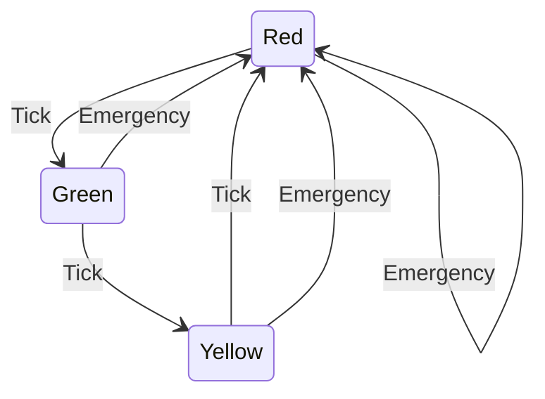
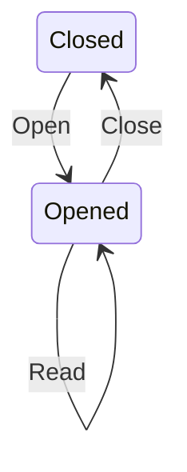
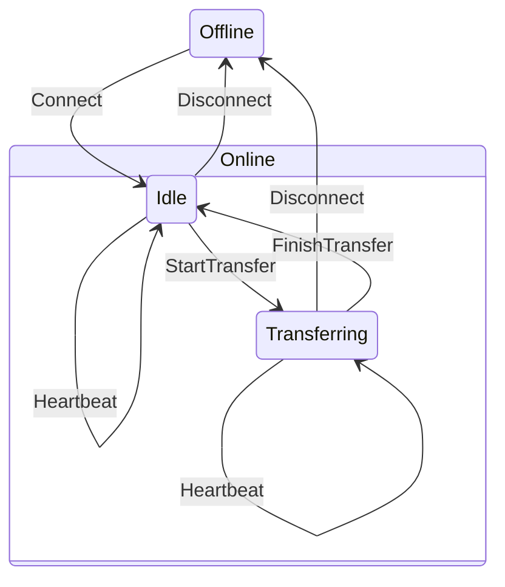

```mermaid
stateDiagram-v2
  %% DoorSystem (orthogonal concurrent regions)
  state DoorSystem {
    state Latch {
      Locked
      Unlocked
      Locked --> Locked : Lock
      Locked --> Unlocked : Unlock
      Unlocked --> Locked : Lock
      Unlocked --> Unlocked : Unlock
    }
    --
    state Swing {
      Closed
      Open
      Closed --> Open : OpenDoor
      Closed --> Closed : CloseDoor
      Open --> Open : OpenDoor
      Open --> Closed : CloseDoor
    }
  }
  note right of DoorSystem
    Container guards (not product states): Open only if Unlocked; Lock only if Closed
  end note
```

# Generated state transition tables and Mermaid diagrams

Product evaluation of shipped pure APIs + structure-preserving hierarchy/orthogonality.
Tables include declared effects from pure steps (not interpreter side effects).
Stdlib only — no FSM/statechart engines.

## TrafficLight

### TrafficLight transition table

| From | Event | To | Kind | Effects | Note |
| --- | --- | --- | --- | --- | --- |
| Red | Tick | Green | ACCEPTED | Audit.LogTransition, Metric.Inc(fsm.transitions), Metric.Inc(light.ticks), DriveLamp(Green) |  |
| Red | Emergency | Red | ACCEPTED | Audit.LogTransition, Metric.Inc(fsm.transitions), Trace.Span(light.emergency,forced Red), DriveLamp(Red) |  |
| Green | Tick | Yellow | ACCEPTED | Audit.LogTransition, Metric.Inc(fsm.transitions), Metric.Inc(light.ticks), DriveLamp(Yellow) |  |
| Green | Emergency | Red | ACCEPTED | Audit.LogTransition, Metric.Inc(fsm.transitions), Trace.Span(light.emergency,forced Red), DriveLamp(Red) |  |
| Yellow | Tick | Red | ACCEPTED | Audit.LogTransition, Metric.Inc(fsm.transitions), Metric.Inc(light.ticks), DriveLamp(Red) |  |
| Yellow | Emergency | Red | ACCEPTED | Audit.LogTransition, Metric.Inc(fsm.transitions), Trace.Span(light.emergency,forced Red), DriveLamp(Red) |  |

## FileProtocol

### FileProtocol transition table

| From | Event | To | Kind | Effects | Note |
| --- | --- | --- | --- | --- | --- |
| Closed | Open | Opened | ACCEPTED | Audit.LogTransition, Metric.Inc(fsm.transitions), Metric.Inc(csp.accept), OpenHandle |  |
| Closed | Read | Closed | REFUSED | Audit.LogRefusal, Metric.Inc(csp.refuse), Trace.Span(csp.refuse,event not in current menu [Open]; refused) | not in menu |
| Closed | Close | Closed | REFUSED | Audit.LogRefusal, Metric.Inc(csp.refuse), Trace.Span(csp.refuse,event not in current menu [Open]; refused) | not in menu |
| Opened | Open | Opened | REFUSED | Audit.LogRefusal, Metric.Inc(csp.refuse), Trace.Span(csp.refuse,event not in current menu [Read, Close]; refused) | not in menu |
| Opened | Read | Opened | ACCEPTED | Audit.LogTransition, Metric.Inc(fsm.transitions), Metric.Inc(csp.accept), ReadChunk |  |
| Opened | Close | Closed | ACCEPTED | Audit.LogTransition, Metric.Inc(fsm.transitions), Metric.Inc(csp.accept), CloseHandle |  |

## Connection

### Connection transition table

| From | Event | To | Kind | Effects | Note |
| --- | --- | --- | --- | --- | --- |
| Offline | Connect | Idle | ACCEPTED | Audit.LogExit(Offline), Audit.LogTransition, Metric.Inc(fsm.transitions), Audit.LogEntry(Online), Metric.Inc(connection.session.open), Trace.Span(connection.session,open), OpenSession, Audit.LogEntry(Idle) |  |
| Offline | Disconnect | Offline | REFUSED | Audit.LogRefusal, Metric.Inc(connection.refuse), Trace.Span(connection.refuse,Disconnect) | no state in hierarchy accepted event |
| Offline | StartTransfer | Offline | REFUSED | Audit.LogRefusal, Metric.Inc(connection.refuse), Trace.Span(connection.refuse,StartTransfer) | no state in hierarchy accepted event |
| Offline | FinishTransfer | Offline | REFUSED | Audit.LogRefusal, Metric.Inc(connection.refuse), Trace.Span(connection.refuse,FinishTransfer) | no state in hierarchy accepted event |
| Offline | Heartbeat | Offline | REFUSED | Audit.LogRefusal, Metric.Inc(connection.refuse), Trace.Span(connection.refuse,Heartbeat) | no state in hierarchy accepted event |
| Idle | Connect | Idle | REFUSED | Audit.LogRefusal, Metric.Inc(connection.refuse), Trace.Span(connection.refuse,Connect) | no state in hierarchy accepted event |
| Idle | Disconnect | Offline | ACCEPTED | Audit.LogExit(Idle), Audit.LogExit(Online), Metric.Inc(connection.session.close), Trace.Span(connection.session,close), CloseSession, Audit.LogTransition, Metric.Inc(fsm.transitions), Audit.LogEntry(Offline) |  |
| Idle | StartTransfer | Transferring | ACCEPTED | Audit.LogExit(Idle), Audit.LogTransition, Metric.Inc(fsm.transitions), Audit.LogEntry(Transferring) |  |
| Idle | FinishTransfer | Idle | REFUSED | Audit.LogRefusal, Metric.Inc(connection.refuse), Trace.Span(connection.refuse,FinishTransfer) | no state in hierarchy accepted event |
| Idle | Heartbeat | Idle | ACCEPTED | Audit.LogTransition, Metric.Inc(fsm.transitions), Metric.Inc(connection.heartbeat), IncHeartbeat |  |
| Transferring | Connect | Transferring | REFUSED | Audit.LogRefusal, Metric.Inc(connection.refuse), Trace.Span(connection.refuse,Connect) | no state in hierarchy accepted event |
| Transferring | Disconnect | Offline | ACCEPTED | Audit.LogExit(Transferring), Audit.LogExit(Online), Metric.Inc(connection.session.close), Trace.Span(connection.session,close), CloseSession, Audit.LogTransition, Metric.Inc(fsm.transitions), Audit.LogEntry(Offline) |  |
| Transferring | StartTransfer | Transferring | REFUSED | Audit.LogRefusal, Metric.Inc(connection.refuse), Trace.Span(connection.refuse,StartTransfer) | no state in hierarchy accepted event |
| Transferring | FinishTransfer | Idle | ACCEPTED | Audit.LogExit(Transferring), Audit.LogTransition, Metric.Inc(fsm.transitions), Audit.LogEntry(Idle) |  |
| Transferring | Heartbeat | Transferring | ACCEPTED | Audit.LogTransition, Metric.Inc(fsm.transitions), Metric.Inc(connection.heartbeat), IncHeartbeat |  |

## DoorSystem

### DoorSystem transition table

| From | Event | To | Kind | Effects | Note |
| --- | --- | --- | --- | --- | --- |
| Locked | Lock | Locked | ACCEPTED | Audit.LogTransition, Metric.Inc(fsm.transitions), Metric.Inc(door.latch.lock), EngageDeadbolt | region=Latch |
| Locked | Unlock | Unlocked | ACCEPTED | Audit.LogTransition, Metric.Inc(fsm.transitions), Metric.Inc(door.latch.unlock), EnergizeStrike | region=Latch |
| Unlocked | Lock | Locked | ACCEPTED | Audit.LogTransition, Metric.Inc(fsm.transitions), Metric.Inc(door.latch.lock), EngageDeadbolt | region=Latch |
| Unlocked | Unlock | Unlocked | ACCEPTED | Audit.LogTransition, Metric.Inc(fsm.transitions), Metric.Inc(door.latch.unlock), EnergizeStrike | region=Latch |
| Closed | OpenDoor | Open | ACCEPTED | Audit.LogTransition, Metric.Inc(fsm.transitions), Metric.Inc(door.swing.open), SoundChime | region=Swing |
| Closed | CloseDoor | Closed | ACCEPTED | Audit.LogTransition, Metric.Inc(fsm.transitions) | region=Swing |
| Open | OpenDoor | Open | ACCEPTED | Audit.LogTransition, Metric.Inc(fsm.transitions), Metric.Inc(door.swing.open), SoundChime | region=Swing |
| Open | CloseDoor | Closed | ACCEPTED | Audit.LogTransition, Metric.Inc(fsm.transitions) | region=Swing |

### Latch transition table

| From | Event | To | Kind | Effects | Note |
| --- | --- | --- | --- | --- | --- |
| Locked | Lock | Locked | ACCEPTED | Audit.LogTransition, Metric.Inc(fsm.transitions), Metric.Inc(door.latch.lock), EngageDeadbolt |  |
| Locked | Unlock | Unlocked | ACCEPTED | Audit.LogTransition, Metric.Inc(fsm.transitions), Metric.Inc(door.latch.unlock), EnergizeStrike |  |
| Unlocked | Lock | Locked | ACCEPTED | Audit.LogTransition, Metric.Inc(fsm.transitions), Metric.Inc(door.latch.lock), EngageDeadbolt |  |
| Unlocked | Unlock | Unlocked | ACCEPTED | Audit.LogTransition, Metric.Inc(fsm.transitions), Metric.Inc(door.latch.unlock), EnergizeStrike |  |

### Swing transition table

| From | Event | To | Kind | Effects | Note |
| --- | --- | --- | --- | --- | --- |
| Closed | OpenDoor | Open | ACCEPTED | Audit.LogTransition, Metric.Inc(fsm.transitions), Metric.Inc(door.swing.open), SoundChime |  |
| Closed | CloseDoor | Closed | ACCEPTED | Audit.LogTransition, Metric.Inc(fsm.transitions) |  |
| Open | OpenDoor | Open | ACCEPTED | Audit.LogTransition, Metric.Inc(fsm.transitions), Metric.Inc(door.swing.open), SoundChime |  |
| Open | CloseDoor | Closed | ACCEPTED | Audit.LogTransition, Metric.Inc(fsm.transitions) |  |

<!-- machines: TrafficLight, FileProtocol, Connection, DoorSystem tables=6 -->
